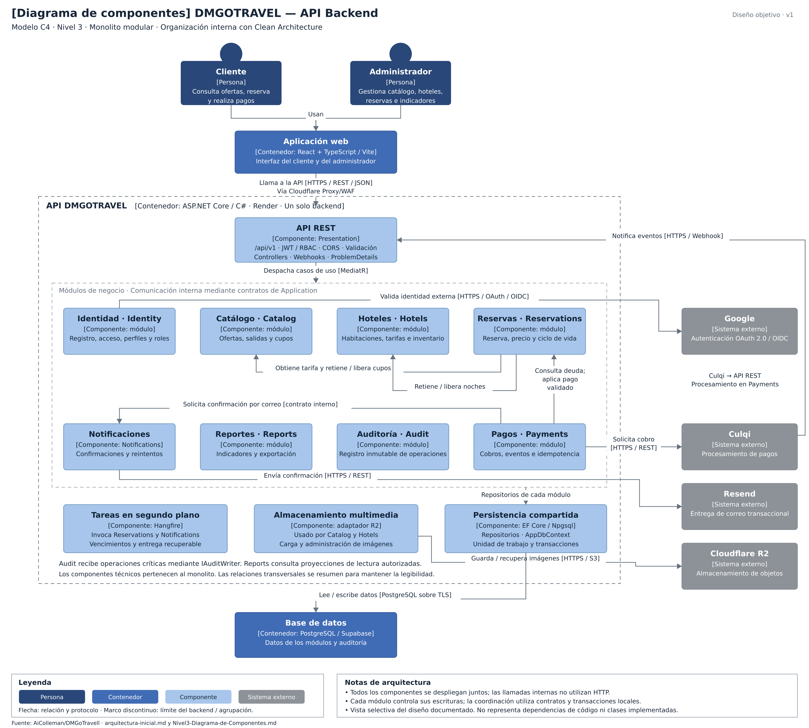

# Componentes arquitectónicos de DMGOTRAVEL

Modelo C4 · Nivel 3 · API Backend · Monolito modular con Clean Architecture.

## Notas

- Todos los componentes del backend se despliegan juntos. Las llamadas internas utilizan contratos, sin HTTP entre módulos.
- Cada módulo controla sus escrituras. Las operaciones compuestas utilizan transacciones locales compartidas cuando corresponde.
- Audit recibe operaciones críticas mediante IAuditWriter. Reports utiliza proyecciones de lectura autorizadas.
- Los webhooks ingresan por API REST y se procesan en Payments con validación de autenticidad e idempotencia.
- El código reproduce los componentes y relaciones de la imagen; Mermaid calcula automáticamente la posición de los elementos.
- Esta vista describe el diseño objetivo documentado, no acredita clases implementadas.
