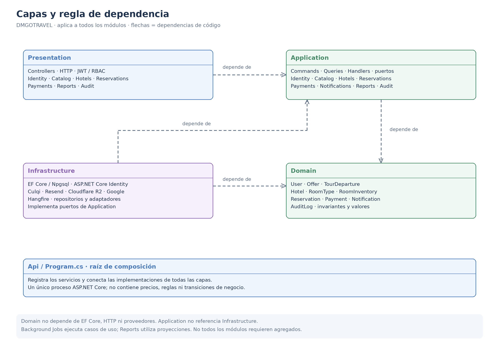
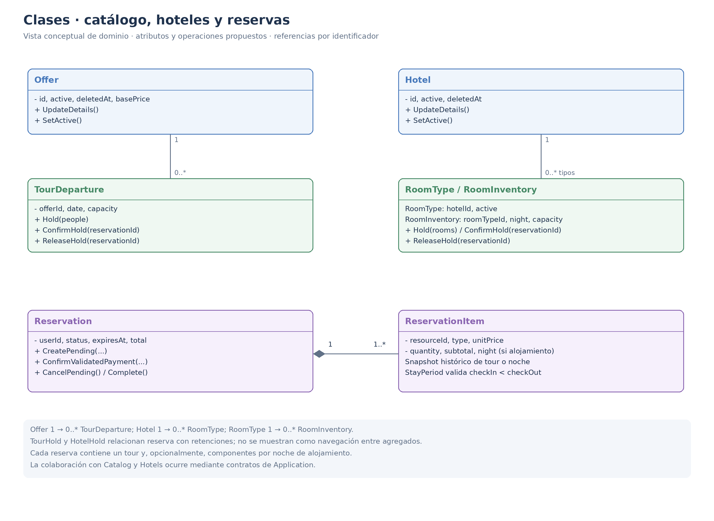
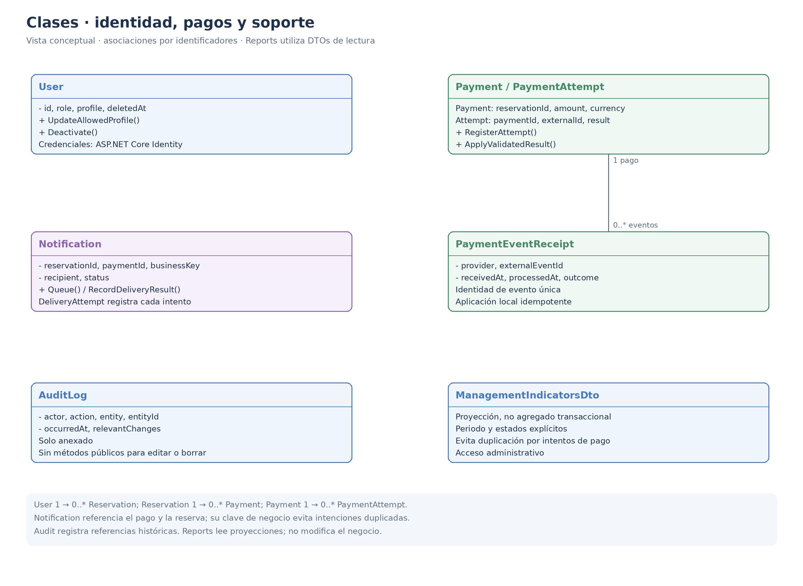
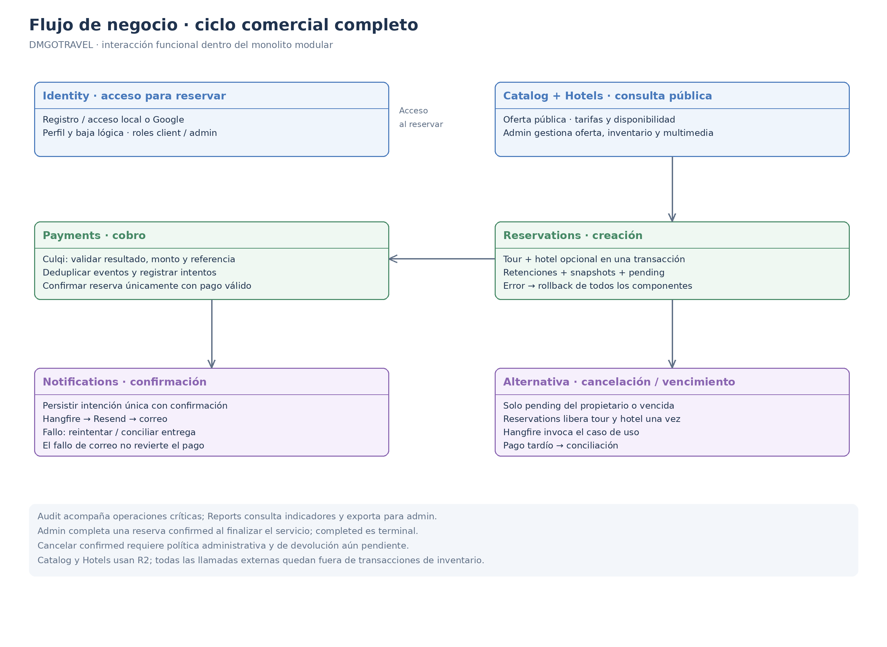

# Diseño interno de módulos

> **Proyecto:** DMGOTRAVEL · **Backend:** ASP.NET Core / C#  
> **Enfoque:** Clean Architecture en un monolito modular ·   
> **Alcance:** todos los módulos funcionales, reglas RN-01 a RN-30 y requisitos RF01 a RF24.  
> **Estado:** diseño objetivo propuesto; los nombres de clases no certifican código ya implementado.

## 1. Propósito

Definir la organización interna de **todo el backend**: responsabilidades, entidades, casos de uso, contratos, adaptadores, dependencias y colaboración entre módulos. Se conserva la estructura de seis secciones del documento Marketplace, ampliando su ejemplo de un solo módulo a todo DMGOTRAVEL.

La lógica del negocio se distribuye entre Domain (invariantes) y Application (coordinación y autorización de casos de uso). Infrastructure implementa persistencia e integraciones y Presentation traduce HTTP. No todos los módulos necesitan agregados complejos: Reports utiliza proyecciones; Background Jobs es un mecanismo de ejecución.

### 1.1 Cobertura funcional

| Módulo | Responsabilidad | Requisitos | Reglas |
|---|---|---|---|
| Identity | Identidad y acceso | RF03, RF04, RF12, RF15 | RN-25–RN-27, RN-30 |
| Catalog | Oferta turística y salidas | RF01, RF02, RF06, RF13, RF24 | RN-01–RN-03, RN-05–RN-08, RN-26, RN-28, RN-30 |
| Hotels | Alojamiento e inventario por noche | RF17, RF18, RF19, RF20, RF24 | RN-01–RN-03, RN-09–RN-13, RN-26, RN-28, RN-30 |
| Reservations | Reservas y ciclo de vida | RF05, RF06, RF08, RF10, RF11, RF14, RF18, RF19, RF21, RF22 | RN-04–RN-14, RN-19–RN-25, RN-28 |
| Payments | Pagos y conciliación | RF07, RF08 | RN-14–RN-18, RN-24, RN-28 |
| Notifications | Confirmaciones al cliente | RF09 | RN-16, RN-28 |
| Reports | Indicadores y exportación | RF16 | RN-25, RN-26 |
| Audit | Trazabilidad de operaciones | RF15, RF23 | RN-28–RN-30 |
| Background Jobs | Ejecutar vencimientos y reintentos recuperables; delegar reglas a Application. | RF09, RF21, RF22 | RN-16, RN-20–RN-22 |

R2 es un adaptador compartido usado por Catalog y Hotels; no se introduce un módulo de negocio independiente para almacenar archivos. La coordinación entre módulos ocurre dentro del mismo proceso y una base PostgreSQL, sin llamadas HTTP internas.

## 2. Estructura de carpetas

```text
src/
├── DMGoTravel.Domain/
│   ├── Common/
│   │   ├── Money.cs                             # Objeto de valor de dinero compartido
│   │   └── DomainRuleException.cs               # Excepciones base de reglas de negocio
│   └── Modules/
│       ├── Identity/                            # 2.2 Identity · Identidad y acceso
│       │   ├── User.cs                          # Entidad de usuario
│       │   └── UserRole.cs                      # Roles de usuario (client, admin, etc.)
│       ├── Catalog/                             # 2.3 Catalog · Oferta turística y salidas
│       │   ├── Offer.cs                         # Entidad de oferta turística
│       │   ├── TourDeparture.cs                 # Salidas de tours y control de capacidad
│       │   ├── TourHold.cs                      # Retención de cupos temporales
│       │   └── MediaAsset.cs                    # Archivos multimedia de la oferta
│       ├── Hotels/                              # 2.4 Hotels · Alojamiento e inventario
│       │   ├── Hotel.cs                         # Entidad de hotel
│       │   ├── RoomType.cs                      # Tipos de habitación
│       │   ├── RoomInventory.cs                 # Inventario de habitaciones por noche
│       │   ├── HotelHold.cs                     # Retención de habitaciones
│       │   └── NightRate.cs                     # Tarifas históricas por noche
│       ├── Reservations/                        # 2.5 Reservations · Reservas y ciclo de vida
│       │   ├── Reservation.cs                   # Agregado de reserva (Aggregate Root)
│       │   ├── ReservationItem.cs               # Histórico / Snapshot de precios
│       │   ├── ReservationStatus.cs             # Estados (pending, confirmed, etc.)
│       │   └── StayPeriod.cs                    # Objeto de valor para noches de estancia
│       ├── Payments/                            # 2.6 Payments · Pagos y conciliación
│       │   ├── Payment.cs                       # Información general del pago
│       │   ├── PaymentAttempt.cs                # Intento de pago Culqi
│       │   └── PaymentEventReceipt.cs           # Recibo/Webhook recibido idempotente
│       ├── Notifications/                       # 2.7 Notifications · Confirmaciones al cliente
│       │   ├── Notification.cs                  # Intención persistente de notificación
│       │   └── DeliveryAttempt.cs               # Intento de envío (historial de reintentos)
│       ├── Reports/                             # 2.8 Reports · Indicadores y exportación
│       │   └── [ModelosDeLectura]               # Modelos sin agregado de escritura
│       └── Audit/                               # 2.9 Audit · Trazabilidad de operaciones
│           └── AuditLog.cs                      # Registro inmutable de auditoría
│
├── DMGoTravel.Application/
│   ├── Common/
│   │   ├── ICurrentUser.cs                      # Identidad del actor autenticado
│   │   ├── IClock.cs                            # Proveedor de tiempo controlable
│   │   ├── IUnitOfWork.cs                       # Transacción local compartida
│   │   ├── IObjectStorage.cs                    # Abstracción para guardado de archivos
│   │   └── Behaviors/                           # Comportamientos de validación de MediatR
│   └── Modules/
│       ├── Identity/
│       │   ├── Commands/
│       │   │   ├── RegisterClient/
│       │   │   ├── LoginWithPassword/
│       │   │   ├── LoginWithGoogle/
│       │   │   ├── UpdateMyProfile/
│       │   │   └── RequestAccountDeletion/
│       │   ├── Queries/
│       │   │   ├── GetMyProfile/
│       │   │   └── ListClients/
│       │   └── Contracts/
│       │       ├── IIdentityService.cs          # Autenticación, roles y perfiles
│       │       ├── IUserRepository.cs
│       │       ├── ITokenService.cs             # Emisión y validación de tokens
│       │       └── IExternalIdentityProvider.cs # Autenticación de terceros (Google OIDC)
│       ├── Catalog/
│       │   ├── Commands/
│       │   │   ├── CreateOffer/
│       │   │   ├── UpdateOffer/
│       │   │   ├── SetOfferActive/
│       │   │   ├── ManageTourDeparture/
│       │   │   ├── UploadOfferMedia/
│       │   │   └── RemoveOfferMedia/
│       │   ├── Queries/
│       │   │   ├── SearchOffers/
│       │   │   ├── GetOfferDetail/
│       │   │   └── GetTourAvailability/
│       │   └── Contracts/
│       │       ├── IOfferRepository.cs
│       │       ├── ICatalogReadStore.cs         # Consultas de catálogo
│       │       └── ITourReservationPort.cs      # API interna para reservar/liberar cupos
│       ├── Hotels/
│       │   ├── Commands/
│       │   │   ├── CreateHotel/
│       │   │   ├── UpdateHotel/
│       │   │   ├── SetHotelActive/
│       │   │   ├── ManageRoomType/
│       │   │   ├── SetNightRate/
│       │   │   ├── AdjustRoomInventory/
│       │   │   └── UploadHotelMedia/
│       │   ├── Queries/
│       │   │   ├── SearchHotels/
│       │   │   ├── GetHotelDetail/
│       │   │   └── GetStayAvailability/
│       │   └── Contracts/
│       │       ├── IHotelRepository.cs
│       │       ├── IHotelReadStore.cs
│       │       └── IHotelReservationPort.cs     # API interna para retenciones hoteleras
│       ├── Reservations/
│       │   ├── Commands/
│       │   │   ├── CreateReservation/
│       │   │   ├── CancelMyPendingReservation/
│       │   │   ├── ExpirePendingReservations/   # Invocado por Background Jobs
│       │   │   ├── ConfirmReservationPayment/
│       │   │   ├── CompleteReservation/
│       │   │   └── CancelConfirmedReservationByAdmin/
│       │   ├── Queries/
│       │   │   ├── GetMyReservations/
│       │   │   ├── GetMyReservationDetail/
│       │   │   └── ListAllReservations/
│       │   └── Contracts/
│       │       ├── IReservationRepository.cs
│       │       ├── IReservationReadStore.cs
│       │       └── IReservationPaymentPort.cs   # API interna para consultar deudas
│       ├── Payments/
│       │   ├── Commands/
│       │   │   ├── StartPayment/
│       │   │   ├── ProcessPaymentResult/
│       │   │   ├── ProcessCulqiWebhook/
│       │   │   └── ReconcilePayment/            # Reconciliación de cobros tardíos o timeouts
│       │   ├── Queries/
│       │   │   └── GetReservationPaymentStatus/
│       │   └── Contracts/
│       │       ├── IPaymentRepository.cs
│       │       ├── IPaymentGateway.cs           # Adaptador de integración Culqi
│       │       └── IPaymentEventStore.cs        # Gestión de idempotencia y eventos recibidos
│       ├── Notifications/
│       │   ├── Commands/
│       │   │   ├── QueuePaymentConfirmation/
│       │   │   ├── SendPendingNotifications/    # Despachador asíncrono desde el job
│       │   │   └── RetryNotification/
│       │   ├── Queries/
│       │   │   └── GetNotificationDeliveryStatus/
│       │   └── Contracts/
│       │       ├── INotificationRepository.cs
│       │       ├── INotificationPort.cs         # API interna para encolar notificaciones
│       │       └── IEmailService.cs             # Adaptador del servicio Resend
│       ├── Reports/
│       │   ├── Commands/
│       │   │   └── ExportManagementReport/
│       │   ├── Queries/
│       │   │   └── GetManagementIndicators/
│       │   └── Contracts/
│       │       ├── IReportsReadStore.cs         # Consultas de reportes e indicadores
│       │       └── IReportExporter.cs           # Generación de archivos exportables
│       └── Audit/
│           ├── Commands/
│           │   └── AppendAuditEntry/            # Registro interno de operaciones
│           ├── Queries/
│           │   └── SearchAuditLogs/
│           └── Contracts/
│               ├── IAuditWriter.cs              # API interna para anexar auditoría
│               └── IAuditReadStore.cs
│
├── DMGoTravel.Infrastructure/
│   ├── Storage/
│   │   └── R2ObjectStorage.cs                   # Implementación compartida Cloudflare R2
│   ├── Persistence/
│   │   ├── AppDbContext.cs                      # Único DbContext transaccional PostgreSQL
│   │   ├── EfUnitOfWork.cs                      # Transacciones ACID entre módulos
│   │   ├── Migrations/
│   │   └── Configurations/                      # Configuraciones de EF Core por módulo
│   │       ├── IdentityConfiguration.cs
│   │       ├── CatalogConfiguration.cs
│   │       ├── HotelsConfiguration.cs
│   │       ├── ReservationsConfiguration.cs
│   │       ├── PaymentsConfiguration.cs
│   │       ├── NotificationsConfiguration.cs
│   │       └── AuditConfiguration.cs
│   ├── BackgroundJobs/                          # 2.10 Tareas en segundo plano (Hangfire)
│   │   ├── ExpireReservationsJob.cs             # Expira reservas pendientes vencidas
│   │   ├── DispatchNotificationsJob.cs          # Envía notificaciones persistentes (Resend)
│   │   └── ReconcilePaymentsJob.cs              # Concilia estados e intentos indeterminados
│   ├── Modules/
│   │   ├── Identity/
│   │   │   ├── AspNetIdentityService.cs
│   │   │   ├── EfUserRepository.cs
│   │   │   ├── JwtTokenService.cs
│   │   │   └── GoogleIdentityProvider.cs
│   │   ├── Catalog/
│   │   │   ├── EfOfferRepository.cs
│   │   │   ├── EfCatalogReadStore.cs
│   │   │   └── TourReservationAdapter.cs        # Implementación de ITourReservationPort
│   │   ├── Hotels/
│   │   │   ├── EfHotelRepository.cs
│   │   │   ├── EfHotelReadStore.cs
│   │   │   └── HotelReservationAdapter.cs       # Implementación de IHotelReservationPort
│   │   ├── Reservations/
│   │   │   ├── EfReservationRepository.cs
│   │   │   └── EfReservationReadStore.cs
│   │   ├── Payments/
│   │   │   ├── EfPaymentRepository.cs
│   │   │   ├── CulqiPaymentGateway.cs
│   │   │   └── EfPaymentEventStore.cs
│   │   ├── Notifications/
│   │   │   ├── EfNotificationRepository.cs
│   │   │   └── ResendEmailService.cs
│   │   ├── Reports/
│   │   │   ├── EfReportsReadStore.cs
│   │   │   └── ManagementReportExporter.cs
│   │   └── Audit/
│   │       ├── EfAuditWriter.cs
│   │       └── EfAuditReadStore.cs
│   └── DependencyInjection.cs                   # Registro técnico de infraestructuras
│
├── DMGoTravel.Presentation/
│   ├── Common/
│   │   ├── ProblemDetails.cs                    # Control global y mapeo de errores HTTP
│   │   ├── CurrentUserAccessor.cs               # Adaptador de contexto HTTP a ICurrentUser
│   │   └── Authorization/                       # Políticas, requerimientos y roles
│   └── Modules/
│       ├── Identity/
│       │   ├── AuthController.cs
│       │   ├── ProfileController.cs
│       │   ├── AdminClientsController.cs
│       │   └── Requests/                        # DTOs HTTP (Login, Registro, etc.)
│       ├── Catalog/
│       │   ├── CatalogController.cs             # Vista pública
│       │   ├── AdminOffersController.cs         # Operaciones administrativas
│       │   └── Requests/
│       ├── Hotels/
│       │   ├── HotelsController.cs              # Vista pública
│       │   ├── AdminHotelsController.cs         # Operaciones administrativas
│       │   └── Requests/
│       ├── Reservations/
│       │   ├── ReservationsController.cs        # Vista de clientes
│       │   ├── AdminReservationsController.cs   # Operaciones administrativas
│       │   └── Requests/
│       ├── Payments/
│       │   ├── PaymentsController.cs
│       │   ├── CulqiWebhookController.cs        # Endpoint de callback y notificaciones Culqi
│       │   └── Requests/
│       ├── Reports/
│       │   └── AdminReportsController.cs        # Exportación y consumo de indicadores
│       └── Audit/
│           └── AdminAuditController.cs          # Búsqueda y visualización de trazas
│
└── DMGoTravel.Api/
    ├── appsettings.json                         # Configuraciones (Hangfire, R2, JWT, Culqi)
    └── Program.cs                               # Host, raíz de composición, registro de módulos 
```

### 2.1 Organización general

Cada ruta de la siguiente tabla es relativa a `src/`. Los módulos mantienen el mismo nombre en todas las capas. Las tablas siguientes detallan el contenido de cada carpeta; no se omiten Catalog, Hotels o Payments detrás de contratos de Reservations.

| Proyecto / carpeta | Contenido |
|---|---|
| `DMGoTravel.Domain/Modules/{Modulo}/` | Entidades, valores y reglas propias. |
| `DMGoTravel.Domain/Common/` | Money, DomainRuleException y primitivas pequeñas sin dependencias externas. |
| `DMGoTravel.Application/Modules/{Modulo}/Commands/{Caso}/` | Command, Handler y Validator por operación de escritura. |
| `DMGoTravel.Application/Modules/{Modulo}/Queries/{Caso}/` | Query, Handler y DTOs de lectura. |
| `DMGoTravel.Application/Modules/{Modulo}/Contracts/` | Puertos públicos y contratos de persistencia del módulo. |
| `DMGoTravel.Application/Common/` | ICurrentUser, IClock, IUnitOfWork, IObjectStorage y comportamientos de validación. |
| `DMGoTravel.Infrastructure/Modules/{Modulo}/` | Repositorios y adaptadores de cada módulo. |
| `DMGoTravel.Infrastructure/Persistence/` | AppDbContext, EfUnitOfWork, migraciones y configuraciones EF por módulo. |
| `DMGoTravel.Infrastructure/Storage/` | R2ObjectStorage y configuración técnica. |
| `DMGoTravel.Infrastructure/BackgroundJobs/` | ExpireReservationsJob, DispatchNotificationsJob y ReconcilePaymentsJob. |
| `DMGoTravel.Presentation/Modules/{Modulo}/` | Controllers, requests, respuestas y metadatos HTTP. |
| `DMGoTravel.Presentation/Common/` | ProblemDetails, usuario HTTP y políticas de autorización. |
| `DMGoTravel.Api/Program.cs` | Host y raíz de composición; ningún cálculo de negocio. |

**Convención:** `CreateOffer` representa la carpeta que contiene `CreateOfferCommand.cs`, `CreateOfferHandler.cs` y `CreateOfferValidator.cs`. Las Queries siguen la misma convención con `Query` y `Handler`. Los archivos enumerados a continuación son el diseño propuesto completo por responsabilidad, no un inventario de clases existentes.


### 2.2 Identity · Identidad y acceso

| Ubicación | Archivos / casos de uso propuestos |
|---|---|
| `Domain/Modules/Identity/` | User.cs, UserRole.cs |
| `Application/Modules/Identity/Commands/` | RegisterClient, LoginWithPassword, LoginWithGoogle, UpdateMyProfile, RequestAccountDeletion |
| `Application/Modules/Identity/Queries/` | GetMyProfile, ListClients |
| `Application/Modules/Identity/Contracts/` | IIdentityService, IUserRepository, ITokenService, IExternalIdentityProvider |
| `Infrastructure/Modules/Identity/` | AspNetIdentityService, EfUserRepository, JwtTokenService, GoogleIdentityProvider |
| `Presentation/Modules/Identity/` | AuthController, ProfileController, AdminClientsController |

**Reglas y comportamiento:** El registro público asigna exclusivamente client. La autenticación local verifica credenciales con ASP.NET Core Identity; Google se valida con OAuth/OIDC antes de vincular una identidad local y emitir tokens propios. El actor se obtiene del contexto autenticado, no del body. Solo se actualizan campos autorizados; no se acepta cambiar rol, estado o identificador desde el perfil. La eliminación es lógica y conserva las referencias históricas. La estrategia de revocación y la política de vinculación de cuentas deben concretarse antes de producción.

**Alternativas que deben resolverse:** Correo duplicado; credenciales inválidas; usuario desactivado; intento de registrar admin; edición de cuenta ajena. Nunca registrar contraseñas ni tokens en auditoría.

### 2.3 Catalog · Oferta turística y salidas

| Ubicación | Archivos / casos de uso propuestos |
|---|---|
| `Domain/Modules/Catalog/` | Offer.cs, TourDeparture.cs, TourHold.cs, MediaAsset.cs |
| `Application/Modules/Catalog/Commands/` | CreateOffer, UpdateOffer, SetOfferActive, ManageTourDeparture, UploadOfferMedia, RemoveOfferMedia |
| `Application/Modules/Catalog/Queries/` | SearchOffers, GetOfferDetail, GetTourAvailability |
| `Application/Modules/Catalog/Contracts/` | IOfferRepository, ICatalogReadStore, ITourReservationPort |
| `Infrastructure/Modules/Catalog/` | EfOfferRepository, EfCatalogReadStore, TourReservationAdapter |
| `Presentation/Modules/Catalog/` | CatalogController, AdminOffersController |

**Reglas y comportamiento:** El catálogo público devuelve únicamente ofertas activas y no eliminadas. Una salida pertenece a una oferta y debe admitir reservas. Las tarifas se obtienen del backend; modificar una oferta no modifica snapshots anteriores. TourDeparture controla capacidad y TourHold identifica los cupos asignados a una reserva. Retener o liberar cupos requiere una transacción protegida contra concurrencia. La gestión administrativa de capacidad no puede situarla por debajo de los compromisos existentes. Esta última restricción es una propuesta derivada para preservar RN-07.

**Alternativas que deben resolverse:** Oferta inactiva; salida inexistente o cerrada; personas no positivas; último cupo solicitado simultáneamente; desactivación durante una reserva; fallo al subir multimedia.

### 2.4 Hotels · Alojamiento e inventario por noche

| Ubicación | Archivos / casos de uso propuestos |
|---|---|
| `Domain/Modules/Hotels/` | Hotel.cs, RoomType.cs, RoomInventory.cs, HotelHold.cs, NightRate.cs |
| `Application/Modules/Hotels/Commands/` | CreateHotel, UpdateHotel, SetHotelActive, ManageRoomType, SetNightRate, AdjustRoomInventory, UploadHotelMedia |
| `Application/Modules/Hotels/Queries/` | SearchHotels, GetHotelDetail, GetStayAvailability |
| `Application/Modules/Hotels/Contracts/` | IHotelRepository, IHotelReadStore, IHotelReservationPort |
| `Infrastructure/Modules/Hotels/` | EfHotelRepository, EfHotelReadStore, HotelReservationAdapter |
| `Presentation/Modules/Hotels/` | HotelsController, AdminHotelsController |

**Reglas y comportamiento:** Hotel y tipo de habitación deben estar activos y relacionados correctamente. El intervalo incluye checkIn y excluye checkOut. La cantidad solicitada representa habitaciones; no se sustituye por huéspedes. Cada noche requiere inventario y tarifa válidos. La retención de todas las noches participa en la misma transacción que el tour. Ajustar inventario no debe invalidar asignaciones previas; se propone rechazar reducciones por debajo de lo comprometido. Los importes históricos no cambian al editar tarifas.

**Alternativas que deben resolverse:** checkOut no posterior; habitaciones no positivas; una noche sin inventario o tarifa; tipo perteneciente a otro hotel; última habitación concurrente; rollback de todas las noches.

### 2.5 Reservations · Reservas y ciclo de vida

| Ubicación | Archivos / casos de uso propuestos |
|---|---|
| `Domain/Modules/Reservations/` | Reservation.cs, ReservationItem.cs, ReservationStatus.cs, StayPeriod.cs |
| `Application/Modules/Reservations/Commands/` | CreateReservation, CancelMyPendingReservation, ExpirePendingReservations, ConfirmReservationPayment, CompleteReservation, CancelConfirmedReservationByAdmin |
| `Application/Modules/Reservations/Queries/` | GetMyReservations, GetMyReservationDetail, ListAllReservations |
| `Application/Modules/Reservations/Contracts/` | IReservationRepository, IReservationReadStore, IReservationPaymentPort |
| `Infrastructure/Modules/Reservations/` | EfReservationRepository, EfReservationReadStore |
| `Presentation/Modules/Reservations/` | ReservationsController, AdminReservationsController |

**Reglas y comportamiento:** Toda reserva nace pending y conserva propietario, vencimiento y snapshots de sus componentes. El tour es obligatorio; el alojamiento es opcional. El total suma personas por tarifa turística y habitaciones por tarifa de cada noche. El cliente consulta sus reservas y solo cancela las propias pendientes. Confirmar requiere evidencia validada por Payments; un administrador no puede sustituirla con una edición manual. El vencimiento lleva a cancelled y libera una sola vez. completed es terminal. CancelConfirmedReservationByAdmin queda condicionado a la política de devolución aún pendiente.

**Alternativas que deben resolverse:** Propiedad incorrecta; pago y vencimiento simultáneos; cancelación repetida; intento de completar pending; pago tardío; componente sin disponibilidad; transiciones desde estados terminales.

### 2.6 Payments · Pagos y conciliación

| Ubicación | Archivos / casos de uso propuestos |
|---|---|
| `Domain/Modules/Payments/` | Payment.cs, PaymentAttempt.cs, PaymentEventReceipt.cs |
| `Application/Modules/Payments/Commands/` | StartPayment, ProcessPaymentResult, ProcessCulqiWebhook, ReconcilePayment |
| `Application/Modules/Payments/Queries/` | GetReservationPaymentStatus |
| `Application/Modules/Payments/Contracts/` | IPaymentRepository, IPaymentGateway, IPaymentEventStore |
| `Infrastructure/Modules/Payments/` | EfPaymentRepository, CulqiPaymentGateway, EfPaymentEventStore |
| `Presentation/Modules/Payments/` | PaymentsController, CulqiWebhookController |

**Reglas y comportamiento:** Cada intento se relaciona con una reserva y conserva identificadores externos. El importe y moneda provienen de la reserva. Se comprueban autenticidad, resultado, importe, moneda y referencia antes de confirmar. El resultado síncrono y el Webhook usan una misma operación idempotente. Una restricción única evita aplicar dos veces el mismo evento y confirmar dos veces el mismo pago. Un timeout queda pendiente de verificación; no equivale a rechazo y no autoriza un nuevo cobro ciego. No se almacena PAN, CVV ni otros datos sensibles de tarjeta.

**Alternativas que deben resolverse:** Webhook repetido o no auténtico; importe o moneda distintos; respuesta desconocida; dos intentos aprobados; pago tras cancelación. Los pagos tardíos se registran para conciliación, sin reactivar automáticamente cupos liberados.

### 2.7 Notifications · Confirmaciones al cliente

| Ubicación | Archivos / casos de uso propuestos |
|---|---|
| `Domain/Modules/Notifications/` | Notification.cs, DeliveryAttempt.cs |
| `Application/Modules/Notifications/Commands/` | QueuePaymentConfirmation, SendPendingNotifications, RetryNotification |
| `Application/Modules/Notifications/Queries/` | GetNotificationDeliveryStatus |
| `Application/Modules/Notifications/Contracts/` | INotificationRepository, INotificationPort, IEmailService |
| `Infrastructure/Modules/Notifications/` | EfNotificationRepository, ResendEmailService |
| `Presentation/Modules/Notifications/` | Sin endpoint público de envío directo |

**Reglas y comportamiento:** La confirmación de pago crea una intención persistente de correo con una clave de negocio única. El envío usa la información histórica de la reserva. Resend se invoca fuera de la transacción que confirmó el pago. Un fallo incrementa intentos y permite recuperación; no revierte la reserva ni el pago. Los reintentos no vuelven a crear la intención. La entrega externa exactamente una vez no se presume: una respuesta perdida después de enviar exige deduplicación del proveedor si está disponible o conciliación.

**Alternativas que deben resolverse:** Resend no disponible; email inválido; reintento concurrente; caída después de enviar y antes de marcar enviado. Formato final del comprobante pendiente; no se inventa facturación electrónica.

### 2.8 Reports · Indicadores y exportación

| Ubicación | Archivos / casos de uso propuestos |
|---|---|
| `Domain/Modules/Reports/` | Sin agregado de escritura propio; modelos de lectura |
| `Application/Modules/Reports/Commands/` | ExportManagementReport |
| `Application/Modules/Reports/Queries/` | GetManagementIndicators |
| `Application/Modules/Reports/Contracts/` | IReportsReadStore, IReportExporter |
| `Infrastructure/Modules/Reports/` | EfReportsReadStore, ManagementReportExporter |
| `Presentation/Modules/Reports/` | AdminReportsController |

**Reglas y comportamiento:** El backend calcula indicadores sobre datos persistidos y con acceso admin. Las consultas no alteran reservas, pagos ni disponibilidad. Deben definir periodo, zona horaria, estados incluidos y criterio de agregación. Se propone separar cantidad de reservas por estado de pagos exitosos conciliados, evitando sumar importes por cada intento. La selección definitiva de indicadores y formato exportable sigue pendiente de acuerdo de negocio.

**Alternativas que deben resolverse:** Filtros inválidos; acceso no administrativo; doble conteo por intentos de pago; datos personales innecesarios en exportación; periodos sin resultados.

### 2.9 Audit · Trazabilidad de operaciones

| Ubicación | Archivos / casos de uso propuestos |
|---|---|
| `Domain/Modules/Audit/` | AuditLog.cs |
| `Application/Modules/Audit/Commands/` | AppendAuditEntry (uso interno) |
| `Application/Modules/Audit/Queries/` | SearchAuditLogs |
| `Application/Modules/Audit/Contracts/` | IAuditWriter, IAuditReadStore |
| `Infrastructure/Modules/Audit/` | EfAuditWriter, EfAuditReadStore |
| `Presentation/Modules/Audit/` | AdminAuditController |

**Reglas y comportamiento:** Cada operación crítica conserva actor, acción, entidad, identificador, instante y cambios relevantes. Los registros son de solo anexado; no se exponen operaciones para editar o borrar auditoría. La auditoría de cambios locales participa en la transacción del cambio. Se identifica explícitamente el actor de sistema en jobs y eventos externos. Se excluyen secretos, datos de tarjeta y tokens de los cambios capturados.

**Alternativas que deben resolverse:** Intento de modificar auditoría; fallo de persistencia en una operación crítica; atribución incorrecta del actor; exposición de secretos; eliminación lógica que rompe referencias históricas.

### 2.10 Background Jobs y servicios compartidos

| Archivo | Responsabilidad | Invoca |
|---|---|---|
| `ExpireReservationsJob.cs` | Buscar lotes de reservas vencidas y ejecutar el caso de uso; reintentar sin doble liberación. | ExpirePendingReservations |
| `DispatchNotificationsJob.cs` | Recuperar intenciones pendientes, reclamar trabajo y despachar envío. | SendPendingNotifications |
| `ReconcilePaymentsJob.cs` | Propuesta para revisar intentos de resultado desconocido, según contrato Culqi. | ReconcilePayment |
| `IClock.cs` | Proveer tiempo controlable para vencimiento y pruebas. | Implementación SystemClock |
| `ICurrentUser.cs` | Identidad y permisos del actor validado. | Adaptador HTTP o actor explícito de sistema |
| `IUnitOfWork.cs` | Transacción local compartida. | EfUnitOfWork |
| `IObjectStorage.cs` | Guardar/eliminar objetos sin exponer R2 al negocio. | R2ObjectStorage |

Los jobs no contienen una copia de las reglas. Cada ejecución crea un scope propio. Un lote no debe mantener bloqueadas todas las reservas durante llamadas externas. Los tiempos de vencimiento, frecuencia y límites de reintento son configurables; no se inventan valores de negocio.

### 2.11 Propiedad de datos y contratos entre módulos

| Dueño | Datos bajo su control | API interna propuesta | Consumidor |
|---|---|---|---|
| Identity | Cuenta, perfil, estado y vinculación externa. | IIdentityService / contexto validado | Casos que necesitan identidad |
| Catalog | Ofertas, salidas y retenciones de cupos. | ITourReservationPort: HoldAndQuote, ConfirmHold, ReleaseHold | Reservations |
| Hotels | Hoteles, tipos, tarifas, inventario y retenciones por noche. | IHotelReservationPort: HoldAndQuote, ConfirmHold, ReleaseHold | Reservations |
| Reservations | Reserva, componentes y ciclo de vida. | IReservationPaymentPort: obtener resumen cobrable y aplicar pago validado | Payments |
| Payments | Intentos, pagos y recibos de eventos. | Resultado validado hacia el puerto de Reservations | Flujo de cobro |
| Notifications | Intenciones y entregas de correo. | INotificationPort: encolar confirmación con clave única | Payments |
| Audit | Registros inmutables. | IAuditWriter: Append | Operaciones críticas |
| Reports | Proyecciones de lectura, sin escritura sobre otros módulos. | IReportsReadStore | Administración |

Ningún módulo modifica directamente tablas ajenas. Los adaptadores de una operación atómica comparten contexto y transacción; ello no transfiere la propiedad de las reglas. Reports puede leer proyecciones acordadas sobre varios módulos, pero no reutiliza sus repositorios para modificar datos. Los contratos públicos retornan DTOs, nunca IQueryable o entidades de EF.

## 3. Capas del módulo y regla de dependencia



| Capa | Responsabilidad | Puede depender de | No puede depender de |
|---|---|---|---|
| Domain | Entidades, objetos de valor, invariantes y transiciones. | Primitivas del dominio / biblioteca base. | Application, Infrastructure, HTTP, EF o SDK. |
| Application | Casos de uso, autorización, DTOs y puertos. | Domain, MediatR, FluentValidation y contratos públicos internos. | Infrastructure, Presentation, DbContext o SDK de proveedores. |
| Infrastructure | EF Core, Identity, Culqi, Resend, R2 y Hangfire. | Application y Domain. | Controllers. |
| Presentation | API REST, JWT, políticas HTTP y errores. | Application y ASP.NET Core. | Repositorios concretos, DbContext, reglas duplicadas. |
| Api / composición | Conectar implementaciones y configurar el host. | Puntos de registro de todas las capas. | No contiene reglas del negocio. |

Las interfaces se sitúan en Application, conforme al enfoque de DMGOTRAVEL, aunque el ejemplo Marketplace las sitúe en dominio. Las referencias `.csproj` y los `using` deben comprobar estas restricciones. Los módulos se separan por namespaces/carpetas en la propuesta; esto requiere disciplina y comprobaciones de dependencias, ya que una carpeta por sí sola no impide accesos cruzados.

## 4. Diagrama de clases

Se presentan vistas por responsabilidad para evitar un diagrama único ilegible. Las referencias entre módulos son identificadores o contratos; no implican navegación EF pública entre agregados.





### 4.1 Notación UML utilizada

| Símbolo | Significado |
|---|---|
| Caja con atributos y operaciones | Clase de dominio propuesta. |
| Línea continua y multiplicidad | Asociación conceptual; no obliga a cargar todo el grafo. |
| Rombo relleno | Composición, parte perteneciente al agregado. |
| Flecha discontinua | Dependencia entre capas en el diagrama de paquetes. |
| `+` / `-` | Operación pública / estado encapsulado. |

### 4.2 Invariantes por agregado

| Agregado / objeto | Invariantes y responsabilidad |
|---|---|
| User | Identidad local única; roles gestionados por rutas autorizadas; baja lógica. Identity conserva hashing y credenciales en Infrastructure. |
| Offer / TourDeparture | Oferta reservable activa; salida válida; capacidad protegida; cantidades positivas. |
| TourHold | Una retención por reserva y salida; transición idempotente entre retenida, consumida y liberada (estados técnicos propuestos). |
| Hotel / RoomType | Tipo asociado al hotel correcto; ambos activos para nuevas reservas. |
| RoomInventory | Clave tipo+noche; inventario no negativo; cambio concurrente protegido. |
| HotelHold | Cantidad de habitaciones por noche; liberación única; todas las noches participan en la transacción. |
| Reservation / ReservationItem | pending al crear; componente turístico obligatorio; alojamiento opcional; importes históricos y moneda consistente; transiciones autorizadas. |
| StayPeriod | checkOut > checkIn; noches en intervalo [checkIn, checkOut). |
| Payment / PaymentAttempt | Intento trazable; importe esperado del backend; resultado validado antes de confirmar. |
| PaymentEventReceipt | Identidad externa única; procesamiento idempotente y resultado persistido. |
| Notification / DeliveryAttempt | Intención única por hecho de negocio; intentos trazables; envío recuperable. |
| AuditLog | Solo anexado, actor y operación identificables, sin secretos. |

### 4.3 Estados oficiales de Reservations

| Origen | Destino | Condición y responsable |
|---|---|---|
| Creación | pending | Recursos retenidos, precios calculados y transacción completa. |
| pending | confirmed | Payments valida pago; Reservations aplica transición y consolida asignaciones. |
| pending | cancelled | Cliente propietario cancela o el plazo vence; liberar una sola vez. |
| confirmed | completed | Administrador registra servicio finalizado. |
| confirmed | cancelled | Solo administración según política de cancelación/devolución pendiente de definición. |
| completed / cancelled | Sin transición de reapertura | Terminales en el ciclo documentado; pago tardío pasa a conciliación. |

No existe un endpoint genérico que acepte cualquier `status`. Cada transición tiene un Command con sus precondiciones. La cancelación pagada no se habilita hasta especificar devolución, inventario y evidencia requeridos.

## 5. Flujo de ejecución: procesos del sistema



### 5.1 Registro, acceso y perfil

1. El visitante se registra con correo y contraseña; RegisterClient impide asignar roles administrativos y crea identidad local client.
2. LoginWithPassword valida credenciales o LoginWithGoogle valida la respuesta del proveedor y la vinculación autorizada.
3. ITokenService emite tokens propios; las siguientes operaciones utilizan la identidad validada.
4. UpdateMyProfile permite solo campos autorizados. RequestAccountDeletion aplica baja lógica y el control de sesiones definido en la política de tokens.
5. Consultar clientes exige admin; modificar un perfil exige propiedad. La validación de acceso permanece en Application aunque no se invoque desde HTTP.

### 5.2 Publicación, inventario y multimedia

1. Admin crea o modifica ofertas/salidas y hoteles/tipos/tarifas/inventario mediante Commands específicos.
2. Domain valida relaciones, cantidades y estados; Infrastructure protege ajustes concurrentes del inventario.
3. La operación guarda cambios y auditoría en una transacción local.
4. Para imágenes, Application valida permisos, tipo, tamaño y destino, y usa IObjectStorage. Los límites concretos son configuración pendiente.
5. La carga R2 no es parte de la transacción SQL: se propone cargar temporalmente, registrar metadatos y publicar la referencia; si falla el registro, se limpia el objeto huérfano mediante un proceso recuperable. La eliminación retira referencias y programa limpieza, evitando borrar objetos aún referenciados.
6. Consultas públicas filtran activos/no eliminados, proyectan DTOs y paginan. La disponibilidad mostrada es orientativa: se revalida transaccionalmente al reservar.

### 5.3 Crear reserva simple o compuesta

| Paso | Colaboradores | Operación |
|---|---|---|
| 1 | Cliente → Controller → MediatR | Solicitud con salida, personas y estancia opcional; sin precio confiable ni propietario arbitrario. |
| 2 | Handler → identidad / validación | Exigir client válido, cantidades positivas y fechas coherentes. |
| 3 | IUnitOfWork → Catalog | Iniciar transacción; validar oferta/salida, proteger cupos y obtener tarifa vigente. |
| 4 | IUnitOfWork → Hotels | Si hay estancia, validar hotel/tipo, retener habitaciones en todas las noches y obtener tarifas. |
| 5 | Reservations | Crear pending con snapshots, total y vencimiento configurable. |
| 6 | Repositorio + Audit | Guardar reserva, retenciones y auditoría; commit único. |
| 7 | Controller → cliente | Devolver reserva pending y total calculado. |
| Alternativa | Cualquier paso local falla | Rollback completo; no queda retención parcial. |

`Total = tarifaTour × personas + Σ(tarifaNoche × habitaciones)`. La moneda debe ser consistente; precisión y redondeo se acuerdan antes de implementar Money. Las tarifas faltantes no se interpretan como cero. Se adquieren recursos en orden determinista y se utilizan bloqueos o actualizaciones condicionales; leer disponibilidad y luego restar sin protección no cumple RN-07.

### 5.4 Pago, confirmación y correo

1. StartPayment verifica propietario, reserva pendiente y vigente, y obtiene importe/moneda del backend. Persiste el intento antes de llamar a Culqi.
2. Culqi se invoca fuera de la transacción de inventario. Un timeout conserva un resultado desconocido para conciliación; no se registra éxito por suposición.
3. El resultado síncrono o Webhook se valida conforme al contrato oficial de Culqi. No se presupone una cabecera de firma concreta.
4. ProcessPaymentResult utiliza una identidad externa y restricciones únicas para deduplicar. En una transacción local carga y protege pago/reserva, valida monto y moneda, aplica la transición y consolida las retenciones.
5. En el mismo commit se guarda el resultado, la auditoría y una intención única de notificación. Una repetición devuelve el resultado ya aplicado.
6. Hangfire recupera intenciones pendientes y Notifications envía mediante Resend. El fallo de correo deja la intención recuperable y no revierte el pago.
7. Si la reserva ya fue cancelada o venció, conservar evidencia y abrir conciliación; no confirmar ni volver a cobrar automáticamente. Dos pagos exitosos distintos para una reserva requieren tratamiento de pago excedente según política pendiente.

La intención persistida evita perder el correo entre el commit y la programación del job. Es una propuesta de entrega recuperable dentro del monolito; no exige RabbitMQ o Kafka.

### 5.5 Cancelación, vencimiento y finalización

1. CancelMyPendingReservation exige propietario y estado pending. ExpirePendingReservations selecciona candidatos, pero vuelve a comprobar estado y hora bajo protección transaccional.
2. Reservations cambia a cancelled y solicita liberar retenciones a Catalog y Hotels en la misma transacción, registrando motivo y auditoría.
3. Cada retención se libera una sola vez; si la operación ya se aplicó, no incrementa otra vez la disponibilidad.
4. Confirmación y cancelación compiten por el mismo estado protegido. Si gana el pago, el vencimiento no cancela; si gana el vencimiento, el pago posterior se concilia.
5. CompleteReservation requiere admin, estado confirmed y servicio finalizado. No libera como cancelación cupos ya consumidos.
6. La cancelación administrativa de confirmed requiere una política de devolución aprobada; no se simula con el caso de cancelación pendiente.

### 5.6 Consultas, reportes y auditoría

Las consultas del cliente incluyen siempre filtro por propietario obtenido de la sesión. Las administrativas exigen admin. Reports agrega en backend sobre snapshots y pagos válidos sin duplicar por intentos; exporta los mismos criterios que la consulta. Audit permite filtros y paginación, pero no mutaciones sobre registros. Se propone auditar cambios administrativos, creación/transiciones de reserva, resultados de pago y baja de cuenta, con actor de sistema para tareas automáticas.

### 5.7 Matriz de aceptación y cobertura

| RF | Caso de uso / módulo | Verificación principal |
|---|---|---|
| RF01–RF02 | SearchOffers / GetOfferDetail · Catalog | Solo ofertas públicas activas; detalle, imágenes e itinerario. |
| RF03–RF04 | RegisterClient / LoginWithPassword / LoginWithGoogle · Identity | Registro solo client; credenciales y proveedor externo válidos. |
| RF05–RF06 | CreateReservation · Reservations + Catalog | pending, cupos protegidos y precio histórico del backend. |
| RF07–RF08 | StartPayment / ProcessPaymentResult · Payments + Reservations | Intentos trazables; sin confirmación por pago inválido. |
| RF09 | QueuePaymentConfirmation / SendPendingNotifications | Intención única y recuperación ante fallo Resend. |
| RF10–RF11 | GetMyReservations / CancelMyPendingReservation | Propiedad y cancelación exclusivamente pending. |
| RF12 | UpdateMyProfile / RequestAccountDeletion | Campos autorizados y baja lógica. |
| RF13 | CreateOffer / UpdateOffer / SetOfferActive | Admin y conservación de snapshots anteriores. |
| RF14 | ListAllReservations / CompleteReservation / cancelación administrativa | Admin; transiciones válidas; pago no sustituible por cambio manual. |
| RF15 | ListClients / SearchAuditLogs | Admin; auditoría no editable. |
| RF16 | GetManagementIndicators / ExportManagementReport | Cálculo backend; filtros consistentes y sin doble conteo. |
| RF17 | SearchHotels / GetStayAvailability | Hotel y tipo activos; tarifas e inventario por noche. |
| RF18–RF19 | CreateReservation · Catalog + Hotels | Tour solo o compuesto; suma correcta y rollback total. |
| RF20 | ManageRoomType / SetNightRate / AdjustRoomInventory | Admin; no reducir inventario bajo compromisos. |
| RF21–RF22 | ExpirePendingReservations / CancelMyPendingReservation | Idempotencia y liberación única frente a concurrencia. |
| RF23 | AppendAuditEntry | Actor, acción, entidad, identificador, fecha y cambios relevantes. |
| RF24 | UploadOfferMedia / UploadHotelMedia | R2 y recuperación de fallos de registro de metadatos. |

Las pruebas de cupos, habitaciones, idempotencia y rollback deben usar PostgreSQL real. Los dobles de repositorio no demuestran garantías de concurrencia. Los requisitos pendientes de diseño detallado del repositorio siguen pendientes: tokens, recuperación/verificación de cuenta, contrato Culqi, devolución, formato de comprobante y detalles de inventario. Este documento propone límites y casos de uso sin presentar esas políticas como aprobadas.

## 6. Código de referencia

Los fragmentos siguientes ilustran el diseño en C#. Se omiten namespaces, constructores de inyección y auxiliares cuando se indica. **No son una aplicación ejecutable completa**: el adaptador de concurrencia y la integración de proveedores requieren implementación y pruebas. No se fija una versión de .NET o SDK que el proyecto aún no haya acordado.

### 6.1 Dominio · entidad e interfaces

Las entidades pertenecen a Domain; los contratos se muestran en este apartado para explicar su relación, pero sus archivos pertenecen a Application.

```csharp
public enum ReservationStatus
{
    Pending,
    Confirmed,
    Completed,
    Cancelled
}

// Fragmento del agregado Reservation.
// La fábrica CreatePending también valida propietario, componentes y total.
public sealed partial class Reservation
{
    public Guid Id { get; private set; }
    public Guid UserId { get; private set; }
    public ReservationStatus Status { get; private set; }
    public DateTimeOffset ExpiresAtUtc { get; private set; }
    public Guid? ConfirmedPaymentId { get; private set; }

    public void ConfirmValidatedPayment(Guid paymentId, DateTimeOffset now)
    {
        if (paymentId == Guid.Empty)
            throw new DomainRuleException("Se requiere un pago validado.");

        if (Status == ReservationStatus.Confirmed &&
            ConfirmedPaymentId == paymentId)
            return; // Repetición de la misma transición.

        if (Status != ReservationStatus.Pending || now >= ExpiresAtUtc)
            throw new DomainRuleException("La reserva requiere conciliación.");

        // Application ya comprobó proveedor, monto, moneda y relación del pago.
        ConfirmedPaymentId = paymentId;
        Status = ReservationStatus.Confirmed;
    }

    public bool CancelPending()
    {
        if (Status == ReservationStatus.Cancelled)
            return false;
        if (Status != ReservationStatus.Pending)
            throw new DomainRuleException("Solo se cancela directamente una reserva pendiente.");

        Status = ReservationStatus.Cancelled;
        return true; // Application libera retenciones en la misma transacción.
    }

    public void Complete()
    {
        if (Status != ReservationStatus.Confirmed)
            throw new DomainRuleException("Solo se completa una reserva confirmada.");
        Status = ReservationStatus.Completed;
    }
}
```

La serialización JSON y la persistencia mapearán los estados a los valores oficiales en minúscula. Este fragmento no verifica Culqi: recibir un `Guid` no demuestra un pago. El caso de uso de Payments valida la evidencia antes de invocar el contrato interno; no se expone este método como endpoint libre.

```csharp
public sealed record StayRequest(
    Guid HotelId,
    Guid RoomTypeId,
    DateOnly CheckIn,
    DateOnly CheckOut,
    int Rooms);

public sealed record CreateReservationCommand(
    Guid TourDepartureId,
    int People,
    StayRequest? Stay) : IRequest<ReservationCreatedDto>;

public interface IReservationRepository
{
    Task AddAsync(Reservation reservation, CancellationToken ct);
    Task<Reservation?> GetForUpdateAsync(Guid id, CancellationToken ct);
}

public interface IUnitOfWork
{
    // Comienza una transacción; ejecuta work; guarda y confirma.
    // Ante cualquier excepción revierte TODOS los cambios participantes.
    Task<T> ExecuteAsync<T>(
        Func<CancellationToken, Task<T>> work,
        CancellationToken ct);
}

public interface ITourReservationPort
{
    // Usa la transacción activa; devuelve precios obtenidos del backend.
    Task<TourHoldQuote> HoldAndQuoteAsync(
        Guid reservationId, Guid departureId, int people, CancellationToken ct);
}

public interface IHotelReservationPort
{
    // Comprueba todas las noches y la relación hotel/tipo de habitación.
    Task<HotelHoldQuote> HoldAndQuoteAsync(
        Guid reservationId, StayRequest stay, CancellationToken ct);
}
```

`TourHoldQuote` y `HotelHoldQuote` son DTOs de Application con referencias de retención, componentes de precio y moneda. No contienen entidades de Catalog/Hotels ni un `DbContext`.

### 6.2 Aplicación · caso de uso

```csharp
// Fragmento: dependencias recibidas por constructor.
public async Task<ReservationCreatedDto> Handle(
    CreateReservationCommand command, CancellationToken ct)
{
    var userId = currentUser.RequireClientId();
    var reservationId = Guid.NewGuid();

    return await unitOfWork.ExecuteAsync(async token =>
    {
        var tour = await tours.HoldAndQuoteAsync(
            reservationId, command.TourDepartureId, command.People, token);

        HotelHoldQuote? hotel = null;
        if (command.Stay is not null)
        {
            hotel = await hotels.HoldAndQuoteAsync(
                reservationId, command.Stay, token);
        }

        var now = clock.UtcNow;
        var reservation = Reservation.CreatePending(
            reservationId,
            userId,
            tour.ToSnapshot(),
            hotel?.ToSnapshots(),
            now,
            now.Add(reservationOptions.PendingLifetime));

        await reservations.AddAsync(reservation, token);
        await audit.AppendAsync(
            AuditEntry.ForCreation(userId, reservation, now), token);

        // ExecuteAsync guarda y confirma antes de devolver este DTO al caller.
        return ReservationCreatedDto.From(reservation);
    }, ct);
}
```

`PendingLifetime` es configurable y debe validarse como positivo al iniciar la aplicación. La fábrica verifica componentes, moneda e invariantes. Los puertos validan registros activos y concurrencia dentro de la transacción; FluentValidation no sustituye estas comprobaciones. Ningún precio proviene del Command.

### 6.3 Infraestructura · adaptador

```csharp
public sealed class EfReservationRepository : IReservationRepository
{
    private readonly AppDbContext db;

    public EfReservationRepository(AppDbContext db) => this.db = db;

    public async Task AddAsync(Reservation reservation, CancellationToken ct)
    {
        await db.Reservations.AddAsync(reservation, ct);
        // No se llama SaveChanges ni Commit aquí.
        // La unidad de trabajo controla el conjunto de la operación.
    }

    public Task<Reservation?> GetForUpdateAsync(Guid id, CancellationToken ct)
    {
        // Debe implementarse con la estrategia real de concurrencia aprobada.
        // Una lectura ordinaria de EF Core NO equivale a un bloqueo.
        throw new NotImplementedException(
            "Implementar control transaccional PostgreSQL y pruebas de concurrencia.");
    }
}
```

La operación intencionalmente incompleta impide presentar una lectura sin protección como implementación correcta. Los adaptadores Catalog y Hotels comparten `AppDbContext` y la transacción de `IUnitOfWork`, aplicando las reglas propias de su módulo.

### 6.4 Presentación · controlador

```csharp
[ApiController]
[Route("api/v1/reservations")]
[Authorize(Roles = "client")]
public sealed class ReservationsController : ControllerBase
{
    private readonly ISender sender;
    public ReservationsController(ISender sender) => this.sender = sender;

    [HttpPost]
    public async Task<IActionResult> Create(
        [FromBody] CreateReservationRequest request,
        CancellationToken ct)
    {
        var result = await sender.Send(new CreateReservationCommand(
            request.TourDepartureId, request.People, request.Stay), ct);

        return Created($"/api/v1/reservations/{result.Id}", result);
    }
}
```

La ruta de consulta individual debe implementarse con control de propiedad. El pipeline valida el Command y el middleware transforma errores conocidos en `ProblemDetails`. Los casos de uso conservan sus controles aunque se invoquen desde un job o una prueba sin Controller.

### 6.5 Raíz de composición

```csharp
// Program.cs: esquema de composición; métodos de extensión propuestos.
builder.Services.AddApplication();
builder.Services.AddInfrastructure(builder.Configuration);
builder.Services.AddPresentation();

// Dentro de AddInfrastructure: registros representativos.
services.AddScoped<IUnitOfWork, EfUnitOfWork>();
services.AddScoped<IReservationRepository, EfReservationRepository>();
services.AddScoped<ITourReservationPort, TourReservationAdapter>();
services.AddScoped<IHotelReservationPort, HotelReservationAdapter>();
services.AddScoped<IPaymentGateway, CulqiPaymentGateway>();
services.AddScoped<IEmailService, ResendEmailService>();
services.AddScoped<IObjectStorage, R2ObjectStorage>();
```

`AppDbContext` se registra una vez por scope. Cada ejecución de Hangfire crea su propio scope. `AddApplication` registra MediatR, validadores y comportamientos comunes; `AddPresentation` configura Controllers, OpenAPI y el adaptador de usuario HTTP. El host configura JWT, autorización, CORS y middleware según los contratos de seguridad acordados.

### 6.6 Contratos del resto de módulos

Los siguientes contratos C# son esquemas propuestos. Los DTOs y tipos de resultado se definen en Application; se omiten sus propiedades para no presentar un SDK completo. Los métodos internos de auditoría y notificación no se exponen como endpoints públicos.

```csharp
// Identity: credenciales y proveedor se resuelven en Infrastructure.
public interface IIdentityService
{
    Task<UserId> RegisterClientAsync(RegisterClientInput input, CancellationToken ct);
    Task<AuthenticatedUser> AuthenticatePasswordAsync(LoginInput input, CancellationToken ct);
    Task UpdateOwnProfileAsync(UserId actor, AllowedProfileChanges changes, CancellationToken ct);
    Task DeactivateOwnAccountAsync(UserId actor, CancellationToken ct);
}

// Catalog: toda retención requiere una transacción local activa.
public interface ITourReservationPort
{
    Task<TourHoldQuote> HoldAndQuoteAsync(Guid reservationId, Guid departureId,
        int people, CancellationToken ct);
    Task ConfirmHoldAsync(Guid reservationId, CancellationToken ct);
    Task ReleaseHoldAsync(Guid reservationId, CancellationToken ct);
}

// Hotels: todas las noches se validan y modifican como una sola operación.
public interface IHotelReservationPort
{
    Task<HotelHoldQuote> HoldAndQuoteAsync(Guid reservationId,
        StayRequest stay, CancellationToken ct);
    Task ConfirmHoldAsync(Guid reservationId, CancellationToken ct);
    Task ReleaseHoldAsync(Guid reservationId, CancellationToken ct);
}

// Payments recibe un resumen; no modifica entidades de otro módulo.
public interface IReservationPaymentPort
{
    Task<PayableReservation> GetPayableAsync(Guid reservationId,
        Guid actorId, CancellationToken ct);
    Task ApplyValidatedPaymentAsync(ValidatedPayment payment, CancellationToken ct);
}

public interface INotificationPort
{
    Task QueuePaymentConfirmationAsync(PaymentConfirmation notice, CancellationToken ct);
}

public interface IReportsReadStore
{
    Task<ManagementIndicatorsDto> GetIndicatorsAsync(ReportFilter filter, CancellationToken ct);
    Task<ReportDataDto> ReadExportAsync(ReportFilter filter, CancellationToken ct);
}

public interface IAuditWriter
{
    Task AppendAsync(AuditEntry entry, CancellationToken ct);
}
```

Las definiciones ampliadas de los puertos Catalog/Hotels sustituyen las versiones abreviadas de 6.1; no se declaran dos interfaces con el mismo nombre. `ValidatedPayment` es un DTO interno producido después de verificar evidencia; no se deserializa directamente desde un body público ni se toma su nombre como prueba de autenticidad.

### 6.7 Operaciones críticas complementarias

Pseudocódigo de coordinación, deliberadamente independiente de un SDK:

```text
CancelMyPendingReservation(actor, reservationId):
  require authenticated client
  within shared transaction:
    reservation = load and protect reservationId
    require reservation belongs to actor
    if already cancelled: return prior result without releasing again
    require pending
    change reservation to cancelled
    Catalog.ReleaseHold(reservationId)   // idempotent
    Hotels.ReleaseHold(reservationId)    // no-op if no hotel
    Audit.Append(actor, cancellation)
    commit

ProcessValidatedPayment(evidence):
  verify provider evidence outside inventory transaction as required
  within shared transaction:
    load and protect payment attempt and reservation in agreed lock order
    if external event already processed: return prior result
    require amount, currency and reservation reference match
    if cancelled or expired: persist evidence and reconciliation case
    else:
      record approved payment
      Reservations.ApplyValidatedPayment(evidence)
      consolidate Catalog and Hotels holds through Reservations
      Notifications.QueuePaymentConfirmation(unique business key)
    persist event receipt and Audit entry
    commit

SendPendingNotification(notificationId):
  claim pending delivery atomically with bounded lease
  send through IEmailService outside SQL transaction
  persist delivery result; retry or reconcile uncertain result
  never alter payment or reservation on delivery failure
```

Un callback malformado o no auténtico no se convierte en `evidence`. La verificación por red no debe mantener bloqueado inventario; después de verificar, se revalida el estado local dentro de la transacción. El caso de conciliación es una propuesta técnica para conservar incidencias, no una autorización automática de reembolso.

### 6.8 Adaptadores y presentación por módulo

| Módulo | Patrón de implementación | Frontera de presentación |
|---|---|---|
| Identity | Adapter hacia ASP.NET Core Identity/Google; separar User de objetos dependientes del framework. | AuthController público limitado; ProfileController autenticado; AdminClientsController admin. |
| Catalog | Repositorio y adaptador transaccional de cupos; R2 para objetos. | Lecturas públicas y escritura admin. |
| Hotels | Repositorio e inventario por noche protegido; R2 compartido. | Lecturas públicas y escritura admin. |
| Reservations | Repository + Unit of Work; Commands por transición. | Propiedad client y operaciones admin separadas. |
| Payments | Adapter Culqi y recibos idempotentes. | Inicio client con propiedad; Webhook autenticado por mecanismo del proveedor, no por JWT client. |
| Notifications | Adapter Resend y cola persistente de intenciones. | Casos internos / jobs, sin endpoint público arbitrario. |
| Reports | Proyecciones de lectura y exportador. | Admin y filtros validados. |
| Audit | Escritor append-only y lector paginado. | Escritura interna; consulta admin. |

Para todos los Controllers: convertir request a Command/Query, invocar ISender y mapear respuesta. No calcular precios en HTTP. Las reglas de propiedad, rol y transición se mantienen en Application para invocaciones desde otras entradas.

### 6.9 Composición completa y criterios de implementación

La raíz registra los servicios de **Identity, Catalog, Hotels, Reservations, Payments, Notifications, Reports y Audit**, además de almacenamiento y jobs. Los repositorios y adaptadores transaccionales comparten el mismo AppDbContext scoped. Las implementaciones de IIdentityService, ITokenService, IPaymentGateway, IEmailService e IObjectStorage se resuelven mediante DI. El registro de un servicio no ejecuta operaciones de negocio.

La solución continúa siendo un backend desplegable único. No se introducen microservicios, Redis, RabbitMQ, Kafka o API Gateway independiente. Las decisiones de separación física o nuevos proveedores requieren ADR.

---