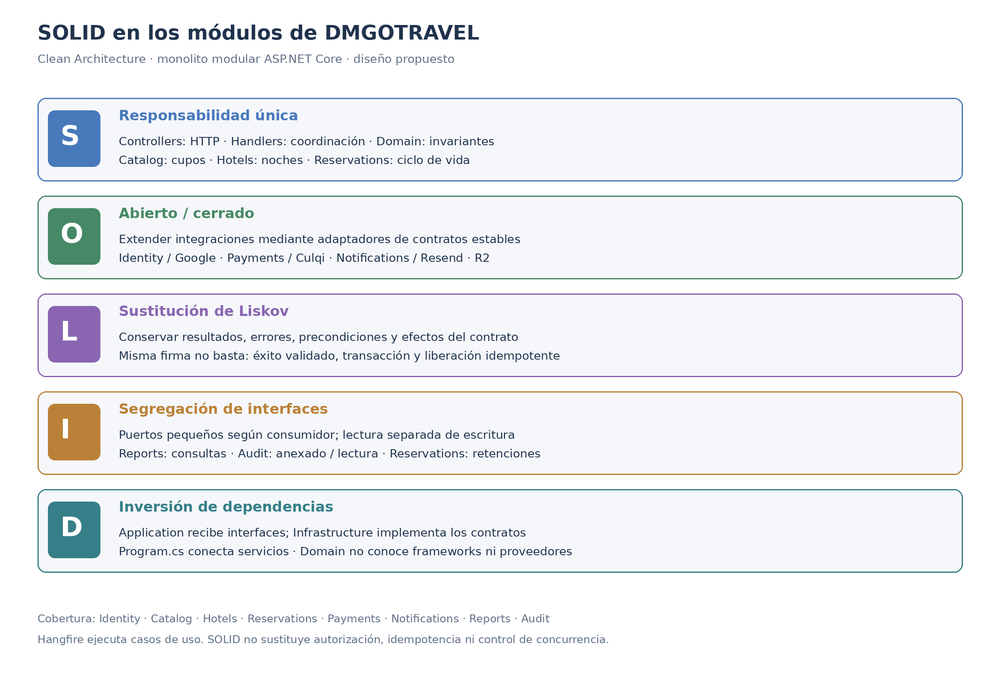

# Principios de diseño (SOLID)

## Objetivo

Documentar cómo se aplican los principios SOLID en el backend de DMGOTRAVEL, organizado con Clean Architecture, para desarrollar sus módulos de forma uniforme y mantener las reglas de negocio independientes de la tecnología.

El documento abarca Identity, Catalog, Hotels, Reservations, Payments, Notifications, Reports y Audit, además de las tareas programadas y las integraciones externas. Los principios orientan el diseño de todo el sistema; no se limitan a la creación de reservas.

## Contexto

- **Estilo:** monolito modular con ASP.NET Core y C#.
- **Enfoque interno:** Clean Architecture: Presentation, Application, Domain e Infrastructure.
- **Módulos de aplicación:** Identity, Catalog, Hotels, Reservations, Payments, Notifications, Reports y Audit.
- **Colaboración principal:** Reservations coordina cupos turísticos y alojamiento opcional; Payments valida el pago; Notifications envía la confirmación y Audit conserva la trazabilidad.
- **Tecnologías:** EF Core/PostgreSQL, MediatR, FluentValidation, ASP.NET Core Identity, Google OAuth/OIDC, Culqi, Resend, Cloudflare R2 y Hangfire.
- **Base:** [requisitos funcionales y reglas de negocio](../../01-analisis-de-sistema/03-requisitos-funcionales.md), [enfoque arquitectónico](../../02-arquitectura/enfoque-arquitectonico.md), [diseño interno de módulos](diseño-interno-de-modulos.md) y [patrones de diseño](patrones-de-diseño.md).

Los archivos citados representan el **diseño propuesto**, no un inventario de código ya implementado. Los contratos se ubican en Application, como establece la arquitectura del proyecto; sus implementaciones técnicas pertenecen a Infrastructure. Domain conserva entidades, objetos de valor e invariantes sin depender de frameworks o proveedores.

## SOLID en los módulos de DMGOTRAVEL

| Principio | Dónde se aplica (capa) | Cómo se cumple en DMGOTRAVEL | Archivos |
|---|---|---|---|
| **S** · Responsabilidad única | Todas las capas y módulos | Cada clase agrupa responsabilidades con un mismo motivo de cambio: Controllers traducen HTTP; Handlers coordinan casos de uso; entidades protegen invariantes; repositorios persisten. Identity gestiona identidad y perfil; Catalog, ofertas y salidas; Hotels, alojamiento e inventario; Reservations, ciclo de vida; Payments, evidencia e intentos; Notifications, entrega; Reports, proyecciones; Audit, trazabilidad. Hangfire invoca casos de uso sin duplicar reglas. | `AuthController.cs`, `CreateOfferHandler.cs`, `AdjustRoomInventoryHandler.cs`, `CreateReservationHandler.cs`, `Reservation.cs`, `ProcessPaymentResultHandler.cs`, `SendPendingNotificationsHandler.cs`, `GetManagementIndicatorsHandler.cs`, `AuditLog.cs`, `ExpireReservationsJob.cs` |
| **O** · Abierto/cerrado | Application e Infrastructure | Los casos de uso se diseñan para admitir nuevas implementaciones de contratos estables. Un proveedor alternativo de pago, correo, almacenamiento o identidad se incorpora mediante otro adaptador y su registro en DI. Esto evita añadir condicionales por proveedor en las reglas de reservas, catálogo o hoteles. No obliga a crear proveedores que el proyecto no necesita. Si una integración introduce capacidades o reglas diferentes, se revisa el contrato explícitamente. | `IPaymentGateway.cs`, `CulqiPaymentGateway.cs`, `IEmailService.cs`, `ResendEmailService.cs`, `IObjectStorage.cs`, `R2ObjectStorage.cs`, `IExternalIdentityProvider.cs`, `GoogleIdentityProvider.cs`, `DependencyInjection.cs` |
| **L** · Sustitución de Liskov | Contratos de Application e implementaciones de Infrastructure | Una implementación puede sustituir a otra solo si conserva precondiciones, resultados, errores y efectos observables del contrato. Un adaptador de pago no informa éxito sin evidencia; un timeout no equivale automáticamente a rechazo. Un repositorio no hace un commit independiente si el contrato exige participar en una transacción. Los puertos de disponibilidad preservan cantidades, tarifas y liberación idempotente. Compartir firma o DTO no basta para cumplir Liskov. | `PaymentGatewayResult.cs`, `IPaymentGateway.cs`, `CulqiPaymentGateway.cs`, `IReservationRepository.cs`, `EfReservationRepository.cs`, `ITourReservationPort.cs`, `IHotelReservationPort.cs`, `EfUnitOfWork.cs` |
| **I** · Segregación de interfaces | Application | Cada consumidor depende únicamente de las operaciones que necesita. Reservations usa puertos de retención, cotización y liberación, sin acceder a toda la administración de ofertas u hoteles. Reports utiliza lecturas y exportación; no necesita métodos de escritura de reservas. Audit separa anexado y consulta, sin ofrecer actualización o eliminación. El envío de correo no se mezcla con autenticación o almacenamiento. | `ITourReservationPort.cs`, `IHotelReservationPort.cs`, `IReservationRepository.cs`, `IReservationReadStore.cs`, `IReportsReadStore.cs`, `IReportExporter.cs`, `IAuditWriter.cs`, `IAuditReadStore.cs`, `IEmailService.cs`, `IObjectStorage.cs` |
| **D** · Inversión de dependencias | Application, Infrastructure y raíz de composición | Los Handlers reciben interfaces por constructor y no crean clientes Culqi, conexiones SQL o servicios Resend. Infrastructure depende de los contratos de Application y del modelo de Domain para implementarlos. `Program.cs` conecta servicios mediante DI. La autenticación, los repositorios, el reloj y el contexto del actor pueden sustituirse para pruebas, manteniendo sus contratos. El contenedor DI por sí solo no garantiza el principio: inyectar un repositorio concreto sigue acoplando el caso de uso. | `CreateReservationHandler.cs`, `ProcessPaymentResultHandler.cs`, `GetManagementIndicatorsHandler.cs`, `IIdentityService.cs`, `ICurrentUser.cs`, `IClock.cs`, `IUnitOfWork.cs`, `EfUnitOfWork.cs`, `DependencyInjection.cs`, `Program.cs` |

La responsabilidad única no significa “una clase con un solo método”. Una entidad puede contener varias operaciones coherentes con sus invariantes, como confirmar o cancelar una reserva. Las reglas se mantienen en su módulo propietario: Catalog controla cupos; Hotels, inventario por tipo y noche; Reservations, estados y componentes; Payments, validación de evidencia; Identity, identidad y acceso.

La aplicación de SOLID no reemplaza las garantías del negocio. Crear una reserva compuesta exige una transacción compartida y control de concurrencia; conservar precios exige snapshots; procesar pagos y vencimientos exige idempotencia persistente. Las pruebas de contrato comprueban sustitución entre adaptadores y las pruebas con PostgreSQL verifican concurrencia y rollback. Un repositorio en memoria no demuestra esas garantías.

## Qué pasaría sin SOLID en DMGOTRAVEL

| Situación real | Sin SOLID | Con SOLID |
|---|---|---|
| Cambia el mecanismo técnico de autenticación o la integración Google. | Los Controllers y casos de uso incorporan detalles del proveedor y deben modificarse conjuntamente. | Identity utiliza contratos; el adaptador concentra el cambio técnico, conservando validación de identidad y políticas de vinculación. |
| Cambia una regla de publicación de ofertas o disponibilidad turística. | La regla aparece repetida en HTTP, consultas y creación de reservas. | Catalog mantiene la regla y sus puertos permiten aplicarla también al reservar. La consulta pública no sustituye la validación transaccional. |
| Se ajusta el inventario hotelero por noche. | Reservations interpreta directamente tablas hoteleras y duplica reglas de Hotels. | Hotels valida tipo, noche y cantidad de habitaciones; Reservations utiliza su contrato dentro de la transacción compartida. |
| Cambia una transición de reserva. | Se modifican estados directamente desde Controllers, jobs y pagos, con validaciones distintas. | Reservation protege las transiciones; sus Handlers coordinan autorización, persistencia y colaboración con otros módulos. |
| Se sustituye Culqi por otro proveedor compatible. | Se reescribe el caso de uso y se propagan estados del proveedor por todo el negocio. | Se implementa otro adaptador que respeta el contrato. Diferencias comerciales o de capacidades se evalúan antes de considerarlo sustituible. |
| Cambia Resend o falla el envío de confirmación. | El envío está mezclado con el cobro y puede provocar reprocesamientos o tratar el pago como fallido. | Notifications gestiona la entrega mediante `IEmailService`; la intención persistida permite recuperar fallos sin revertir el pago. SOLID facilita esta separación, pero no proporciona durabilidad por sí solo. |
| Cambia el almacenamiento de imágenes. | Catalog y Hotels contienen llamadas directas al proveedor y manejo repetido de credenciales. | `IObjectStorage` mantiene estable la interacción y el adaptador concentra R2. Los fallos entre carga y metadatos requieren limpieza recuperable. |
| Se incorpora un indicador o formato de reporte. | El reporte modifica servicios de reservas o reutiliza escrituras innecesarias. | Reports utiliza proyecciones y un contrato de exportación, preservando autorización administrativa y criterios de cálculo. |
| Se consulta auditoría o se registra una operación crítica. | Un repositorio CRUD general permite editar o borrar el historial y expone métodos que el consumidor no necesita. | `IAuditWriter` solo anexa y `IAuditReadStore` solo consulta; la persistencia y los permisos respaldan la inmutabilidad requerida. |
| Hangfire reintenta el vencimiento de una reserva. | El job contiene otra versión de la cancelación y puede devolver cupos dos veces. | El job delega en el caso de uso de vencimiento; la transición y liberación idempotentes se ejecutan en una transacción. La idempotencia debe implementarse explícitamente. |
| Se quiere probar una operación de negocio. | Se necesitan proveedores reales incluso para probar decisiones del Handler. | Domain se prueba de forma aislada y Application usa dobles de contratos. Los adaptadores, la autenticación real y las transacciones mantienen pruebas de integración propias. |

## Relación con Clean Architecture y los patrones

| Principio | Lo cumple en el proyecto |
|---|---|
| Responsabilidad única | Separación por módulos y capas: Presentation traduce HTTP; Application coordina; Domain protege invariantes; Infrastructure persiste e integra. Mediator facilita el despacho hacia casos de uso concretos, pero no evita por sí solo Handlers con demasiadas responsabilidades. |
| Abierto/cerrado y Liskov | Adapter permite extender integraciones de pagos, identidad, correo y almacenamiento. La sustitución exige contratos semánticos y pruebas de comportamiento; implementar la misma interfaz no garantiza resultados equivalentes. |
| Segregación de interfaces | Puertos específicos de Application: `ITourReservationPort`, `IHotelReservationPort`, `IPaymentGateway`, `IReservationReadStore`, `IReportsReadStore`, `IAuditWriter` e `IAuditReadStore`. CQRS ayuda a separar necesidades de lectura y escritura sin requerir bases de datos distintas. |
| Inversión de dependencias | Repository, Adapter y el contrato Unit of Work desacoplan los casos de uso de detalles técnicos. Las dependencias permitidas son Presentation → Application, Application → Domain e Infrastructure → Application/Domain. El host conecta las implementaciones; Domain no conoce ASP.NET Core, EF Core, Culqi, Resend ni R2. |

La estructura de carpetas y el uso de patrones no bastan para demostrar SOLID: deben revisarse dependencias reales, responsabilidades, contratos y pruebas. El diseño mantiene un único backend desplegable; aplicar estos principios no requiere microservicios ni introducir tecnologías ajenas a las decisiones del proyecto.
