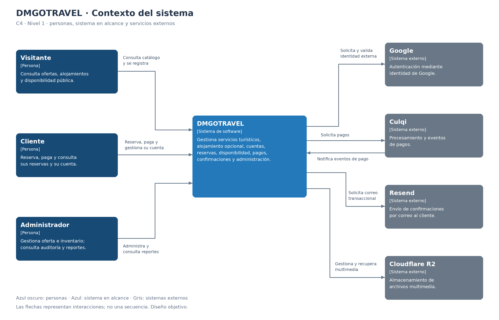

# Nivel 1 · Diagrama de contexto del sistema

> **Proyecto:** DMGOTRAVEL  
---

## 1. Objetivo

Mostrar **DMGOTRAVEL como una sola caja**: quiénes utilizan la plataforma de servicios turísticos y con qué sistemas externos se comunica. Esta vista presenta el alcance general del sistema sin descomponer su implementación.

| Aspecto | Descripción |
|---|---|
| Pregunta que responde | ¿Qué es DMGOTRAVEL, quién lo usa y con quién se integra? |
| Audiencia | Negocio, docentes, equipo de desarrollo y operaciones. |
| Qué **no** muestra | Frameworks, servidores, bases de datos, módulos ni componentes internos. |
| Siguiente nivel | `Nivel2-DiagramadeContenedores.md` |

---

## 2. Diagrama

Las flechas indican el sentido de las interacciones descritas; no representan una secuencia temporal ni el recorrido de cada petición. Las personas se muestran en azul oscuro, el sistema en alcance en azul y los sistemas externos en gris.

---

## 3. Personas (usuarios)

| Persona | Descripción | Qué hace en el sistema |
|---|---|---|
| **Visitante** | Persona que consulta la oferta pública sin autenticarse. No es un rol de cuenta adicional. | Explora ofertas turísticas activas, detalles, itinerarios, imágenes y alojamientos; consulta información de disponibilidad y puede registrarse como cliente. |
| **Cliente** | Usuario registrado con rol `client` que contrata servicios turísticos. | Inicia sesión con credenciales locales o Google; crea reservas de tour con alojamiento opcional, realiza pagos, consulta sus reservas y cancela las propias pendientes. Actualiza sus datos autorizados y solicita la baja lógica de su cuenta. |
| **Administrador** | Usuario autorizado con rol `admin`, responsable de la operación de DMGOTRAVEL. | Gestiona ofertas, hoteles, tipos de habitación, tarifas, inventario y multimedia; consulta clientes y todas las reservas, aplica transiciones válidas y revisa auditoría, indicadores y reportes. |

El visitante y el cliente pueden ser la misma persona en momentos distintos. No se incorporan vendedores, hoteleros con portal propio ni operadores de ERP como actores, porque esos accesos no están definidos en los requisitos actuales. La administración de hoteles se realiza dentro de DMGOTRAVEL por el administrador.

---

## 4. Sistemas

| Sistema | Tipo | Responsabilidad | Quién lo construye |
|---|---|---|---|
| **DMGOTRAVEL** | Sistema en alcance. | Permite consultar y administrar ofertas turísticas y alojamiento, gestionar cuentas, disponibilidad, reservas y pagos, enviar confirmaciones y obtener reportes y auditoría. | El equipo del proyecto. |
| **Culqi** | Sistema externo de pagos. | Procesa operaciones de pago y proporciona resultados y eventos que DMGOTRAVEL debe validar antes de confirmar una reserva. | Proveedor Culqi. |
| **Resend** | Sistema externo de correo. | Recibe solicitudes de envío y gestiona el envío de correos transaccionales de confirmación al cliente. | Proveedor Resend. |
| **Google** | Sistema externo de identidad. | Permite autenticar al usuario mediante su identidad de Google; DMGOTRAVEL valida el resultado y administra la cuenta y sus tokens propios. | Google. |
| **Cloudflare R2** | Sistema externo de almacenamiento multimedia. | Almacena objetos multimedia del catálogo, incluidos los asociados a ofertas y hoteles, y permite su gestión y recuperación. | Cloudflare. |

R2 se representa por la integración de almacenamiento que consume DMGOTRAVEL, no como base de datos del negocio. La persistencia propia, la aplicación web, las tareas programadas y los módulos forman parte de la caja DMGOTRAVEL y se detallan en otros niveles. El hosting, DNS y protección perimetral corresponden a vistas de contenedores o despliegue; no se convierten en actores del negocio en este diagrama.

---

## 5. Relaciones

| Origen | Destino | Descripción | Protocolo |
|---|---|---|---|
| Visitante | DMGOTRAVEL | Consulta ofertas y alojamientos públicos, detalles y disponibilidad; solicita registrarse. | — |
| Cliente | DMGOTRAVEL | Se autentica, reserva, inicia pagos, consulta sus reservas y gestiona su cuenta. | — |
| Administrador | DMGOTRAVEL | Administra oferta e inventario, gestiona reservas y consulta clientes, auditoría y reportes. | — |
| DMGOTRAVEL | Culqi | Solicita procesar pagos y consulta resultados cuando corresponde al flujo definido. | HTTPS / API del proveedor. |
| Culqi | DMGOTRAVEL | Notifica eventos de pago para validación y procesamiento idempotente. | HTTPS / Webhooks. |
| DMGOTRAVEL | Resend | Solicita enviar al cliente la confirmación o comprobante después de validar el pago. | HTTPS / API del proveedor. |
| DMGOTRAVEL | Google | Solicita autenticación externa y valida la información de identidad devuelta. | HTTPS / OAuth 2.0 y OpenID Connect. |
| DMGOTRAVEL | Cloudflare R2 | Almacena, recupera y gestiona archivos multimedia del catálogo. | HTTPS / API compatible con S3. |

> En el nivel 1 no se indica el protocolo entre personas y sistema: eso se detalla en el nivel 2. Los protocolos de integración son una descripción general; los contratos y mecanismos concretos deben detallarse en los documentos técnicos correspondientes.

La relación con Google resume el flujo de autenticación; no descompone redirecciones del navegador ni intercambios de tokens. La relación con Resend resume la solicitud de entrega al cliente; el diagrama no modela su buzón o proveedor de correo. Culqi se muestra con dos relaciones porque las notificaciones asíncronas son una interacción distinta de las solicitudes de pago.

---

## 6. Decisiones y supuestos

| # | Decisión o supuesto | Motivo |
|---|---|---|
| 1 | DMGOTRAVEL se representa como un único sistema. | El nivel 1 explica el contexto; no separa frontend, backend, módulos ni tareas internas. |
| 2 | Se distinguen visitante, cliente y administrador. | El catálogo es público, las reservas y perfiles requieren identidad y las operaciones administrativas requieren rol `admin`. |
| 3 | La autenticación local pertenece a DMGOTRAVEL; Google es una alternativa externa. | El sistema administra credenciales locales y emite sus propios tokens después de autenticar al usuario. No utiliza Google como base de datos de usuarios del negocio. |
| 4 | Culqi procesa pagos; DMGOTRAVEL no almacena datos sensibles de tarjetas. | Respeta RN-18 y separa la gestión del servicio turístico del procesamiento de tarjetas. |
| 5 | Una reserva se confirma únicamente tras validar un pago exitoso. | Los eventos de Culqi se procesan de manera idempotente; un cambio administrativo manual no sustituye la evidencia del pago. |
| 6 | Resend es el canal de correo definido para las confirmaciones. | RF09 ya establece este proveedor; no se deja el canal de notificación como una decisión pendiente ni se añaden SMS o WhatsApp. |
| 7 | Cloudflare R2 es una dependencia externa de multimedia. | RF24 define el almacenamiento externo de archivos. Las reservas, pagos y datos del negocio permanecen bajo responsabilidad de DMGOTRAVEL. |
| 8 | Los hoteles se administran en DMGOTRAVEL, sin una integración externa de reservas hoteleras definida. | No se presume una API de hoteles, un ERP, un courier ni un portal de vendedores que el proyecto no contempla. |
| 9 | Los sistemas externos no se modifican como parte del proyecto. | DMGOTRAVEL se integra mediante sus contratos y adapta las respuestas a sus reglas internas. |
| 10 | La figura describe el diseño objetivo documentado. | No certifica que las integraciones estén desplegadas ni que existan contratos productivos configurados. |

### Pendientes por definir

| Tema | Detalle |
|---|---|
| Integración detallada de Culqi | Precisar el flujo de pago, operaciones utilizadas, validación de autenticidad de eventos, conciliación de resultados desconocidos y tratamiento de pagos tardíos o duplicados. |
| Cancelaciones posteriores al pago | Definir la política administrativa de cancelación y devolución; no habilitar una devolución automática por asumirla en este diagrama. |
| Identidad y sesiones | Especificar expiración, rotación y revocación de tokens, vinculación de cuentas Google, recuperación de contraseña y verificación de correo. |
| Comprobante y correo | Definir contenido, formato y política de reintentos. El uso de Resend ya está decidido; no se presupone un comprobante tributario electrónico. |
| Gestión de multimedia | Detallar acceso público o firmado, límites y validaciones de carga, conservación y limpieza de archivos sin referencia. |

---
