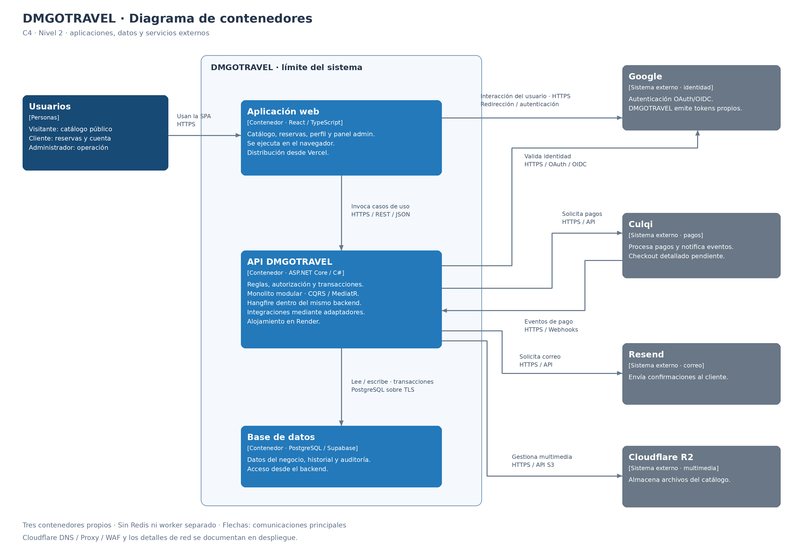

# Nivel 2 · Diagrama de contenedores

> **Proyecto:** DMGOTRAVEL  
> **Modelo:** C4 · Nivel 2 de 4 ·

---

## 1. Objetivo

Abrir la caja «DMGOTRAVEL» del nivel 1 y mostrar sus **contenedores**: la aplicación web, la API y el almacén de datos del negocio, indicando sus tecnologías, responsabilidades y comunicaciones con servicios externos.

| Aspecto | Descripción |
|---|---|
| Pregunta que responde | ¿De qué aplicaciones y almacenes de datos se compone DMGOTRAVEL y cómo se comunican? |
| Audiencia | Arquitectos, desarrolladores y operaciones. |
| Qué es un contenedor | Una aplicación o almacén de datos con responsabilidad propia; en C4 no equivale necesariamente a un contenedor Docker. |
| Nivel anterior | `Nivel1-DiagramadeContextodelSistema.md` |
| Siguiente nivel | `Nivel3-Diagrama-de-Componentes.md` |

---

## 2. Diagrama

El límite de DMGOTRAVEL contiene la aplicación web, la API y la base de datos del negocio. PostgreSQL sigue siendo un almacén propio del sistema aunque esté alojado en Supabase. R2 conserva la clasificación de servicio externo utilizada en el nivel 1. Las flechas representan comunicaciones principales, no una secuencia de ejecución.

Vercel y Render son destinos de alojamiento, no contenedores funcionales adicionales. Cloudflare DNS y Proxy/WAF pertenecen a la vista de despliegue: el acceso a la API atraviesa ese perímetro, aunque la relación lógica se represente directamente entre aplicación web y API.

---

## 3. Contenedores

| Contenedor | Tecnología | Responsabilidad | Datos que maneja |
|---|---|---|---|
| **Aplicación web** | SPA · React + TypeScript; construcción con Vite; distribución desde Vercel. | Se ejecuta en el navegador. Ofrece catálogo público, registro y acceso, selección de tour y alojamiento, pago, consulta de reservas, perfil y panel administrativo. | Estado de interfaz, filtros, formularios y datos obtenidos de la API. No es la fuente de verdad de precios, disponibilidad, roles o estados. La persistencia de tokens en el navegador queda pendiente del diseño de sesiones. |
| **API DMGOTRAVEL** | ASP.NET Core / C#; Clean Architecture; CQRS con MediatR, FluentValidation y EF Core/Npgsql; alojamiento en Render. | Expone REST, autentica y autoriza, aplica reglas de negocio, coordina transacciones e integra proveedores. Es un **monolito modular** con Identity, Catalog, Hotels, Reservations, Payments, Notifications, Reports y Audit. Hangfire ejecuta tareas dentro del mismo backend. | Procesa identidades, ofertas, inventario, reservas, pagos, notificaciones y reportes; mantiene el estado duradero en PostgreSQL y los archivos en R2. No almacena datos sensibles de tarjeta. |
| **Base de datos del negocio** | PostgreSQL alojado en Supabase. | Conserva datos y restricciones de integridad; respalda las transacciones de reservas simples y compuestas, la idempotencia y la trazabilidad. Solo el backend accede a ella. | Usuarios y perfiles; ofertas y salidas; hoteles, tipos y disponibilidad por noche; reservas, componentes y precios históricos; intentos de pago, eventos procesados, auditoría, metadatos de archivos e intenciones de correo propuestas para entrega recuperable. |

Los cuatro proveedores externos son **Culqi** (pagos), **Resend** (correo), **Google** (identidad) y **Cloudflare R2** (multimedia). No se convierten en módulos propios ni se descomponen internamente en este nivel.

Los trabajos Hangfire no se muestran como un servicio separado. Su almacenamiento persistente y la configuración de recuperación deben concretarse; se propone utilizar PostgreSQL con almacenamiento compatible, sin presentar esa configuración como implementada. La propuesta de intenciones de correo persistidas evita perder envíos entre la confirmación del pago y la ejecución del trabajo.

---

## 4. Relaciones

| Origen | Destino | Descripción | Protocolo |
|---|---|---|---|
| Visitante, Cliente, Administrador | Aplicación web | Acceden a la interfaz correspondiente desde el navegador. El visitante consulta contenido público; cliente y administrador acceden a sus funciones autorizadas. | HTTPS para entrega de la aplicación y recursos; interacción local en el navegador. |
| Aplicación web | API DMGOTRAVEL | Consulta catálogo y disponibilidad; envía solicitudes de autenticación, reservas, pagos, perfil y administración. | HTTPS / REST / JSON. |
| API DMGOTRAVEL | Base de datos del negocio | Lee y escribe información; controla concurrencia y ejecuta transacciones completas de reservas e inventario. | Protocolo PostgreSQL sobre TCP con TLS; operaciones SQL mediante EF Core/Npgsql. |
| API DMGOTRAVEL | Culqi | Solicita operaciones de pago con el importe obtenido de la reserva y consulta resultados cuando lo requiere el flujo definido. | HTTPS / API del proveedor. |
| Culqi | API DMGOTRAVEL | Envía eventos de pago al endpoint de Webhooks para validar autenticidad, importe, moneda y referencia y procesarlos de forma idempotente. | HTTPS / Webhooks. |
| API DMGOTRAVEL | Resend | Solicita el envío de confirmación o comprobante después de un pago validado. Los fallos de correo no revierten el pago. | HTTPS / API del proveedor. |
| API DMGOTRAVEL | Google | Participa en la autenticación externa y valida la identidad recibida antes de emitir tokens propios de DMGOTRAVEL. | HTTPS / OAuth 2.0 y OpenID Connect. |
| Aplicación web / navegador | Google | El usuario realiza la interacción de autenticación mediante redirección o flujo autorizado por Google. No se exponen secretos del servidor. | HTTPS; flujo OAuth/OIDC, pendiente de detalle. |
| API DMGOTRAVEL | Cloudflare R2 | Guarda, recupera y gestiona multimedia del catálogo y sus referencias. | HTTPS / API compatible con S3. |

La autenticación con correo y contraseña es propia de DMGOTRAVEL; no exige utilizar Google. Los retornos y redirecciones del acceso Google se resumen en la relación de autenticación y se detallarán en el contrato de seguridad.

El flujo concreto de captura/tokenización del pago sigue pendiente. Si el mecanismo oficial de Culqi requiere interacción directa del navegador con su interfaz o SDK público, se incorporará a la vista detallada sin exponer credenciales secretas ni enviar datos sensibles de tarjeta al backend. El diagrama no certifica un checkout todavía no definido.

La consulta de disponibilidad es informativa: la API vuelve a validarla y protege cupos y habitaciones al crear la reserva. Las llamadas a Culqi, Resend o R2 se realizan fuera de la transacción de inventario; PostgreSQL no puede revertir efectos en proveedores externos.

---

## 5. Decisiones arquitectónicas reflejadas

| Decisión | Alternativa descartada | Motivo |
|---|---|---|
| Un único contenedor de backend, organizado como monolito modular. | Microservicios y despliegues separados por módulo en V1. | Mantiene una sola aplicación desplegable y permite coordinar reservas, cupos e inventario mediante transacciones locales. |
| Frontend separado del backend: SPA + API REST. | Generar toda la interfaz dentro del backend. | Permite evolucionar y desplegar interfaz y API de forma independiente, conforme a la arquitectura documentada. |
| PostgreSQL como almacén del negocio, accesible desde el backend. | Acceso directo del navegador a la base de datos o una base distinta por módulo. | Centraliza autorización, reglas y transacciones; evita que el cliente modifique disponibilidad o estados fuera de los casos de uso. |
| Sin contenedor Redis en la primera versión. | Copiar la caché Redis del proyecto de referencia. | La arquitectura de DMGOTRAVEL no lo incluye. Añadir una caché requiere una necesidad medida y nunca sustituye la validación transaccional de inventario. |
| Hangfire forma parte del backend. | Worker independiente o microservicio de vencimiento en V1. | Reutiliza los casos de uso del monolito para vencimientos y reintentos; el trabajo debe ser recuperable e idempotente. |
| Culqi, Resend, Google y R2 se integran mediante adaptadores. | Propagar sus SDK y formatos por el dominio. | Separa las reglas de negocio de los detalles de los proveedores y mantiene el diseño de Clean Architecture. |
| Credenciales secretas y operaciones privilegiadas de integración en la API. | Incluir secretos en la SPA. | Protege las credenciales. Las interacciones públicas necesarias de Google o del checkout no otorgan al navegador autoridad para confirmar pagos. |
| Cloudflare Proxy/WAF protege el acceso a la API; no hay API Gateway independiente. | Introducir un gateway adicional en V1. | La solución publica una única API; el perímetro ya definido se representa con más detalle en despliegue. |
| Resend procesa correo y R2 almacena multimedia. | Añadir ERP, courier, SMS o proveedores de hoteles no contemplados. | Conserva el alcance funcional y las integraciones confirmadas del proyecto. |

Los contenedores describen el diseño objetivo, no prueban que existan despliegues productivos. La ubicación, número de instancias, conectividad de proveedores y configuración de almacenamiento de trabajos deben verificarse en el diseño de despliegue. No se asume una red privada compartida entre Render y Supabase.

---

## 6. Seguridad entre contenedores

| Comunicación | Medida |
|---|---|
| Navegador → aplicación web | Entrega por HTTPS. Evitar secretos en archivos compilados, recursos y configuración pública. |
| Aplicación web → API: consultas públicas | HTTPS, validación de parámetros, paginación y límites de uso. El catálogo público no requiere JWT por el solo hecho de llamar a la API. |
| Aplicación web → API: funciones protegidas | Validar tokens propios, rol y propiedad de recursos. El registro público solo crea clientes; las operaciones administrativas exigen `admin`. La estrategia de almacenamiento, expiración, rotación y revocación de tokens queda pendiente. |
| Aplicación web → API: acceso entre orígenes | CORS restringido a orígenes autorizados; no sustituye la autenticación. Definir protección CSRF según el mecanismo de sesión elegido. |
| API → PostgreSQL/Supabase | Conexión cifrada con validación de certificado, credenciales de mínimo privilegio y gestión segura de secretos. Aplicar restricciones de conectividad que permita el entorno; no asumir acceso únicamente por red interna sin comprobar el despliegue. |
| API → Culqi | Credenciales secretas solo en backend; importe y moneda obtenidos de la reserva. No almacenar PAN, CVV ni otros datos sensibles de tarjeta. |
| Culqi → API | Validar autenticidad según el contrato oficial, referencia, monto y moneda; deduplicar eventos de forma persistente. Un Webhook no utiliza el JWT del cliente como mecanismo de autenticación. |
| API / navegador ↔ Google | Validar el flujo OAuth/OIDC y la identidad emitida; proteger correlación de solicitudes, redirecciones y vinculación de cuentas según el flujo elegido. Los secretos de servidor no se distribuyen en la SPA. |
| API → Resend | Credencial del proveedor en backend; limitar los datos enviados y evitar secretos en plantillas o registros. Controlar reintentos y acceso a intenciones de correo. |
| API → Cloudflare R2 | Permisos mínimos sobre objetos; validar archivos y referencias. Definir acceso público o firmado y evitar cargas arbitrarias o exposición de objetos privados. |
| Operación de Hangfire dentro de la API | Acceso administrativo restringido al panel si se habilita; jobs con contexto y permisos adecuados, ejecuciones idempotentes y registros sin secretos. |
| Perímetro → API | Mantener TLS y las reglas de Cloudflare Proxy/WAF; definir cómo impedir el acceso indebido que eluda el perímetro conforme a las capacidades de Render. El WAF no reemplaza la autorización de la aplicación. |

La confirmación de pagos, cancelación, vencimiento y liberación de recursos se protegen también frente a concurrencia. Las consultas del cliente se filtran por su identidad validada y la auditoría registra actor, acción, entidad, identificador, instante y cambios relevantes sin permitir edición desde la aplicación.

---
