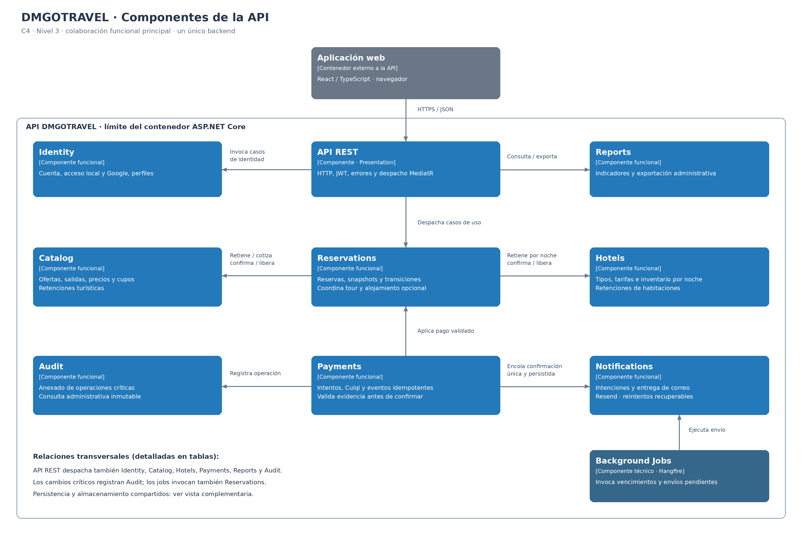
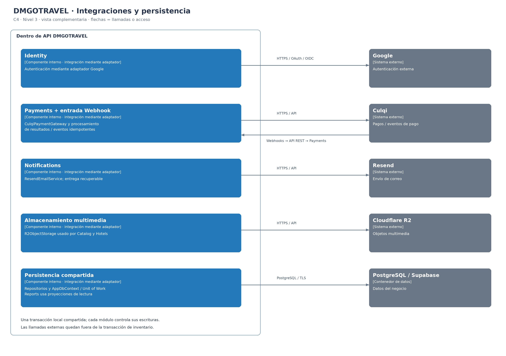

# Nivel 3 · Diagrama de componentes

> **Proyecto:** DMGOTRAVEL · **Contenedor detallado:** API DMGOTRAVEL  
> **Modelo:** C4 · Nivel 3 de 4 · 

---

## 1. Objetivo

Abrir el contenedor **API DMGOTRAVEL** del nivel 2 y mostrar sus componentes: módulos funcionales y servicios técnicos compartidos, responsabilidades, colaboración y acceso a PostgreSQL y proveedores externos.

| Aspecto | Descripción |
|---|---|
| Pregunta que responde | ¿Cómo se divide el backend por dentro y qué hace cada parte? |
| Audiencia | Arquitectos y desarrolladores. |
| Qué es un componente | Un conjunto de funcionalidades con responsabilidad definida y contratos de acceso. Los módulos de negocio y los servicios técnicos representados viven dentro del mismo backend; no son despliegues separados. |
| Nivel anterior | `Nivel2-DiagramadeContenedores.md` |
| Siguiente nivel | `Nivel4-DiagramadeCodigo.md` |

---

## 2. Diagrama

La vista principal muestra los componentes y sus colaboraciones funcionales principales. Para mantener legibilidad, las relaciones transversales de entrada HTTP, auditoría y persistencia se explican mediante las tablas y la vista complementaria; la ausencia de una flecha en la figura principal no implica que esa relación no exista.

Las flechas indican llamadas o acceso a contratos; no representan dependencias entre proyectos `.csproj` ni una secuencia temporal. Los detalles de clases, interfaces y métodos corresponden al nivel 4. Los archivos y contratos enumerados a continuación constituyen una propuesta de implementación coherente con la arquitectura documentada.

---

## 3. Componentes

| Componente | Responsabilidad | Funcionalidades principales | Carpeta en el código |
|---|---|---|---|
| **API REST** | Entrada HTTP del backend. | Controllers, rutas versionadas, validación de solicitudes, JWT, políticas HTTP, CORS, límites de uso, OpenAPI y ProblemDetails. Despacha casos de uso mediante MediatR; recibe Webhooks de Culqi. | `src/DMGoTravel.Presentation/Modules/` y `src/DMGoTravel.Presentation/Common/` |
| **Identity** | Identidad, cuentas y acceso. | Registro público exclusivamente `client`; autenticación local y Google; tokens propios; perfil autorizado, baja lógica y consulta administrativa de clientes. | `Modules/Identity/` en Domain, Application e Infrastructure. |
| **Catalog** | Oferta turística y disponibilidad de salidas. | Ofertas activas, itinerarios, tarifas, salidas, cupos y retenciones; administración de oferta y referencias de imágenes. Conserva la autoridad sobre reglas turísticas. | `Modules/Catalog/` en Domain, Application e Infrastructure. |
| **Hotels** | Alojamiento, tarifas e inventario por noche. | Hoteles, tipos de habitación, noches, precios, cantidades de habitaciones y retenciones; administración e imágenes del alojamiento. | `Modules/Hotels/` en Domain, Application e Infrastructure. |
| **Reservations** | Reservas y ciclo de vida. | Reserva turística con alojamiento opcional; precio total y snapshots históricos; creación pending; consultas con propiedad; confirmación por pago validado, cancelación, vencimiento y finalización. | `Modules/Reservations/` en Domain, Application e Infrastructure. |
| **Payments** | Procesamiento y trazabilidad del pago. | Integración Culqi, intentos, validación de resultados, deduplicación de eventos, confirmación mediante contrato de Reservations y registro de resultados desconocidos para conciliación. | `Modules/Payments/` en Domain, Application e Infrastructure. |
| **Notifications** | Confirmaciones por correo. | Intenciones persistidas propuestas para entrega recuperable; envío por Resend; control de intentos, reintentos y resultados sin revertir pagos. | `Modules/Notifications/` en Domain, Application e Infrastructure. |
| **Reports** | Indicadores y exportación administrativa. | Queries y proyecciones sobre datos del negocio; filtros de periodo y estado; exportación; prevención del doble conteo por intentos de pago. No modifica agregados ajenos. | `Modules/Reports/` en Application e Infrastructure. |
| **Audit** | Registro de operaciones críticas. | Anexar actor, acción, entidad, identificador, instante y cambios relevantes; consulta administrativa; sin operaciones de edición o eliminación desde la aplicación. | `Modules/Audit/` en Domain, Application e Infrastructure. |
| **Background Jobs** | Ejecución programada y recuperación de trabajo. | Hangfire invoca vencimiento de reservas y envío pendiente. La conciliación programada de pagos es una propuesta sujeta al contrato Culqi. No duplica reglas de negocio. | `src/DMGoTravel.Infrastructure/BackgroundJobs/` |
| **Persistencia compartida** | Acceso técnico y coordinación transaccional. | AppDbContext, configuraciones EF Core, migraciones y unidad de trabajo; repositorios de cada módulo participan en una transacción común cuando corresponde. | `src/DMGoTravel.Infrastructure/Persistence/` y repositorios en `Infrastructure/Modules/{Modulo}/`. |
| **Almacenamiento multimedia** | Adaptación del almacenamiento externo. | Implementación de IObjectStorage para R2; gestión de objetos, referencias y limpieza recuperable propuesta para archivos huérfanos. | `src/DMGoTravel.Infrastructure/Storage/`; contrato en `Application/Common/`. |

`Domain`, `Application` e `Infrastructure` abrevían los proyectos `src/DMGoTravel.Domain/`, `src/DMGoTravel.Application/` y `src/DMGoTravel.Infrastructure/`. Cada módulo conserva sus contratos en Application. La raíz de composición `src/DMGoTravel.Api/Program.cs` conecta implementaciones y configura el host; no constituye un módulo de negocio.

---

## 4. Relaciones entre componentes

| Origen | Destino | Descripción | Tipo de comunicación |
|---|---|---|---|
| Aplicación web | API REST | Consulta contenido público e invoca operaciones de cliente y administración. | HTTPS / REST / JSON. |
| API REST | Identity, Catalog, Hotels, Reservations, Payments, Reports y Audit | Convierte solicitudes a Commands/Queries y despacha Handlers; aplica controles HTTP. Los casos de uso conservan autorización y propiedad. | Llamada en proceso mediante MediatR. |
| Casos de uso protegidos | Contexto de identidad validada | Obtienen actor y permisos mediante ICurrentUser o un actor de sistema explícito; no aceptan propietario o rol confiable desde el body. | Contrato interno; no llamada HTTP a Identity por operación. |
| Reservations | Catalog | Valida salida y oferta, obtiene tarifa, retiene cupos y confirma o libera retenciones. | API pública interna: ITourReservationPort. |
| Reservations | Hotels | Valida hotel/tipo y todas las noches, obtiene tarifas y retiene, confirma o libera habitaciones. | API pública interna: IHotelReservationPort. |
| Payments | Reservations | Obtiene un resumen cobrable y solicita aplicar un pago ya validado. Reservations protege la transición de estado. | API pública interna: IReservationPaymentPort. |
| Payments | Notifications | Solicita una intención única de confirmación junto con el commit local de un pago válido. | Contrato interno: INotificationPort; intención persistida propuesta, no evento volátil como única garantía. |
| Identity, Catalog, Hotels, Reservations y Payments | Audit | Registran operaciones críticas, actor y cambios pertinentes; sin exponer secretos. | Contrato interno IAuditWriter; misma transacción del cambio local cuando corresponde. |
| Background Jobs | Reservations | Ejecuta vencimiento de pending, revalida estado bajo protección transaccional y libera una sola vez. | Caso de uso interno ExpirePendingReservations. |
| Background Jobs | Notifications | Recupera intenciones pendientes y ejecuta envío o reintento. | Caso de uso interno; trabajo persistente recuperable. |
| Background Jobs | Payments | Propuesta: revisar resultados desconocidos, sin generar nuevos cobros ciegos. | Caso de uso interno de conciliación; sujeto al diseño detallado. |
| Catalog y Hotels | Almacenamiento multimedia | Almacenan o retiran imágenes mediante un contrato común; validación funcional y permisos permanecen en el módulo consumidor. | IObjectStorage; implementación en Infrastructure. |
| Módulos con escritura | Persistencia compartida | Sus repositorios utilizan contexto y conexión scoped; IUnitOfWork delimita transacciones entre participantes. | Contratos internos e implementación EF Core; sin HTTP interno. |
| Reports | Puertos/proyecciones de lectura | Obtiene datos acordados de reservas, pagos y otros módulos para calcular indicadores y exportar. | IReportsReadStore; lectura sin modificar datos ajenos. |

Crear una reserva compuesta coordina Catalog y Hotels dentro de una sola transacción local. Si falta una noche o un cupo, se revierte todo. Las tarifas del backend se conservan como snapshots y no cambian cuando el administrador modifica precios.

Confirmación, cancelación y vencimiento se serializan sobre el estado protegido de la reserva. Los eventos repetidos no duplican confirmación, notificación ni liberación. Un pago tardío se registra para conciliación; no reactiva automáticamente una reserva cuyos recursos se liberaron. La cancelación de reservas pagadas depende de la política administrativa y de devolución aún pendiente.

Reports constituye una excepción explícita de lectura mediante proyecciones acordadas; no se autoriza acceso arbitrario de cualquier módulo a tablas ajenas. Notifications no necesita un endpoint público que permita enviar correos arbitrarios.

---

## 5. Relaciones con contenedores y sistemas externos

| Componente | Destino | Descripción | Protocolo | Patrón aplicado |
|---|---|---|---|---|
| Repositorios y persistencia compartida | PostgreSQL / Supabase | Persiste datos bajo la propiedad de cada módulo, restricciones, eventos procesados y auditoría. Coordina cambios atómicos entre participantes. | PostgreSQL sobre TCP con TLS; EF Core/Npgsql. | Repository y Unit of Work. |
| Reports y lectores específicos | PostgreSQL / Supabase | Ejecuta proyecciones de lectura autorizadas y paginadas; no utiliza los reportes para modificar el negocio. | PostgreSQL sobre TLS. | CQRS / puertos de lectura. |
| Identity | Google | Valida la autenticación externa mediante integración OAuth/OIDC; la cuenta local y tokens propios siguen bajo DMGOTRAVEL. | HTTPS / OAuth 2.0 y OpenID Connect. | Adapter. |
| Payments | Culqi | Solicita pagos y consulta resultados conforme al flujo acordado. | HTTPS / API del proveedor. | Adapter. |
| API REST → Payments | Culqi como origen de eventos | El proveedor llama al endpoint de Webhooks; API REST entrega el evento a Payments para autenticidad y procesamiento idempotente. | Culqi → API: HTTPS / Webhook; despacho interno en proceso. | Adapter e Idempotent Consumer propuesto. |
| Notifications | Resend | Envía confirmaciones cuyo pago ya fue validado; registra resultados y recupera fallos. | HTTPS / API del proveedor. | Adapter; intención persistente tipo Transactional Outbox propuesta. |
| Almacenamiento multimedia | Cloudflare R2 | Guarda, recupera y elimina objetos solicitados por Catalog y Hotels. | HTTPS / API compatible con S3. | Adapter. |

Las llamadas externas no se ejecutan dentro de la transacción de inventario. Un rollback PostgreSQL no deshace un envío de correo, una carga R2 ni un cobro Culqi. La entrega externa exactamente una vez no se presume: una respuesta perdida requiere deduplicación compatible con el proveedor o conciliación.

Hangfire requiere almacenamiento persistente para sus trabajos. Se propone un almacenamiento compatible con PostgreSQL; proveedor, esquema y configuración deben cerrarse en el diseño técnico. No se introduce Redis, un broker distribuido, ERP, courier ni una API hotelera inexistente en el alcance actual.

El navegador participa en la autenticación Google y puede participar en la captura/tokenización oficial de Culqi según el checkout que se defina. Estas interacciones externas a la API se explican en el nivel 2; nunca exponen secretos del backend ni autorizan al navegador a confirmar por sí mismo una reserva.

---

## 6. Reglas del monolito modular

| # | Regla | Motivo |
|---|---|---|
| 1 | Todos los componentes de la API, incluido Hangfire, se despliegan como un único backend. | Los módulos no son microservicios ni requieren llamadas HTTP internas. |
| 2 | Un módulo utiliza otro mediante contratos públicos de Application. | Mantiene límites funcionales y evita dependencia de implementaciones, repositorios o entidades internas ajenas. |
| 3 | Cada módulo controla las escrituras sobre sus datos. | Un contexto compartido no autoriza a modificar tablas ajenas; la colaboración ocurre mediante el módulo propietario. |
| 4 | Reports utiliza proyecciones de lectura explícitas y acordadas sobre varios módulos. | Permite indicadores transversales sin conceder escrituras ni acceso indiscriminado a datos internos. |
| 5 | Una operación compuesta utiliza contexto y transacción compartidos, con un único commit. | Impide retenciones parciales y mantiene consistencia entre reserva, tour y alojamiento. |
| 6 | El inventario se protege con bloqueos o actualizaciones condicionales y restricciones de base de datos. | Consultar disponibilidad antes de guardar no evita sobreventa por concurrencia. |
| 7 | Cada integración tiene una implementación técnica centralizada. | Culqi pertenece a Payments; Resend a Notifications; Google a Identity; R2 es un adaptador compartido por Catalog y Hotels. |
| 8 | Cada módulo sigue Clean Architecture. | Presentation depende de Application; Application de Domain; Infrastructure de Application y Domain. Las reglas no dependen de ORM o SDK. |
| 9 | Los jobs invocan los mismos casos de uso y preservan idempotencia. | Evita reglas duplicadas y doble liberación o confirmación por reintentos. |
| 10 | La notificación posterior al pago conserva una intención persistida y única. | Evita depender exclusivamente de un evento en memoria que se pierda al reiniciar el proceso. Es una propuesta de implementación para RF09 y RN-16. |
| 11 | Los permisos y la propiedad se verifican también en los casos de uso. | Invocar un Handler desde un job u otra entrada no debe eludir la seguridad aplicada en HTTP. |
| 12 | Auditoría es de solo anexado y la baja conserva el historial requerido. | Cumple trazabilidad, inmutabilidad desde la aplicación y eliminación lógica de cuentas, ofertas y hoteles. |

Los nombres de contratos y rutas de código son propuestas, no evidencia de clases existentes. Los detalles de sesiones, checkout Culqi, devoluciones, comprobantes, almacenamiento de jobs y política de multimedia siguen sujetos a definición técnica y de negocio.

---
