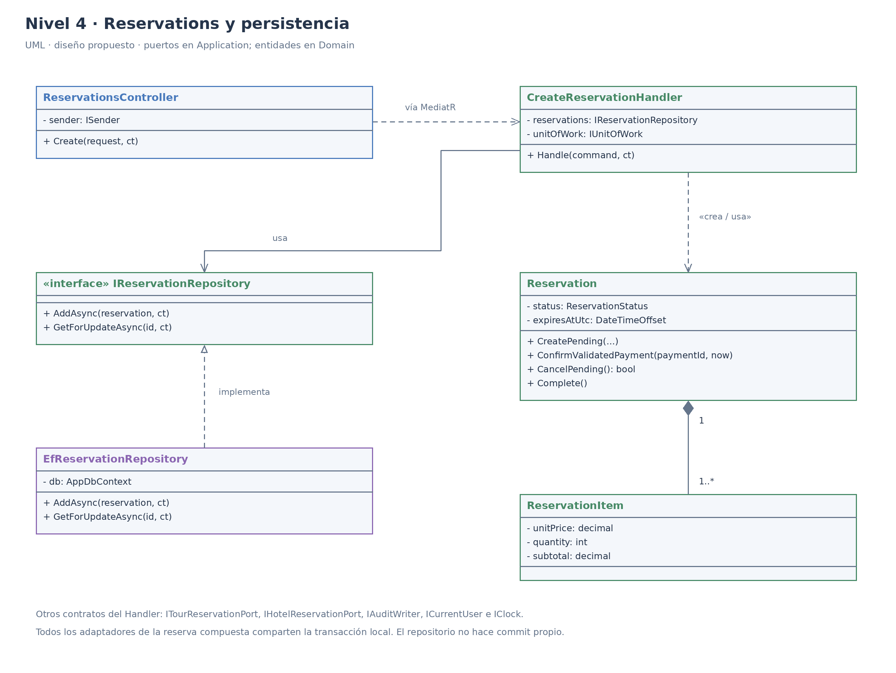
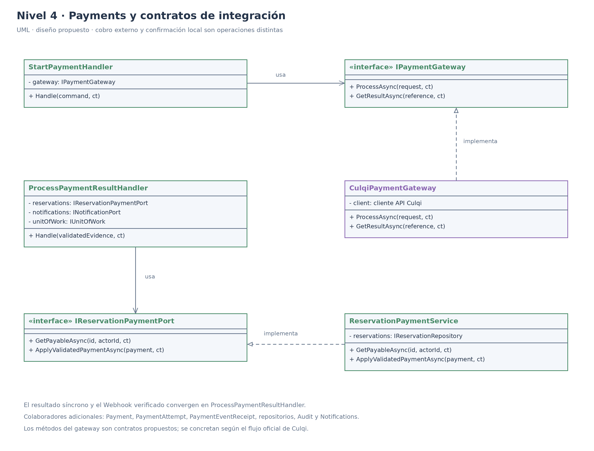
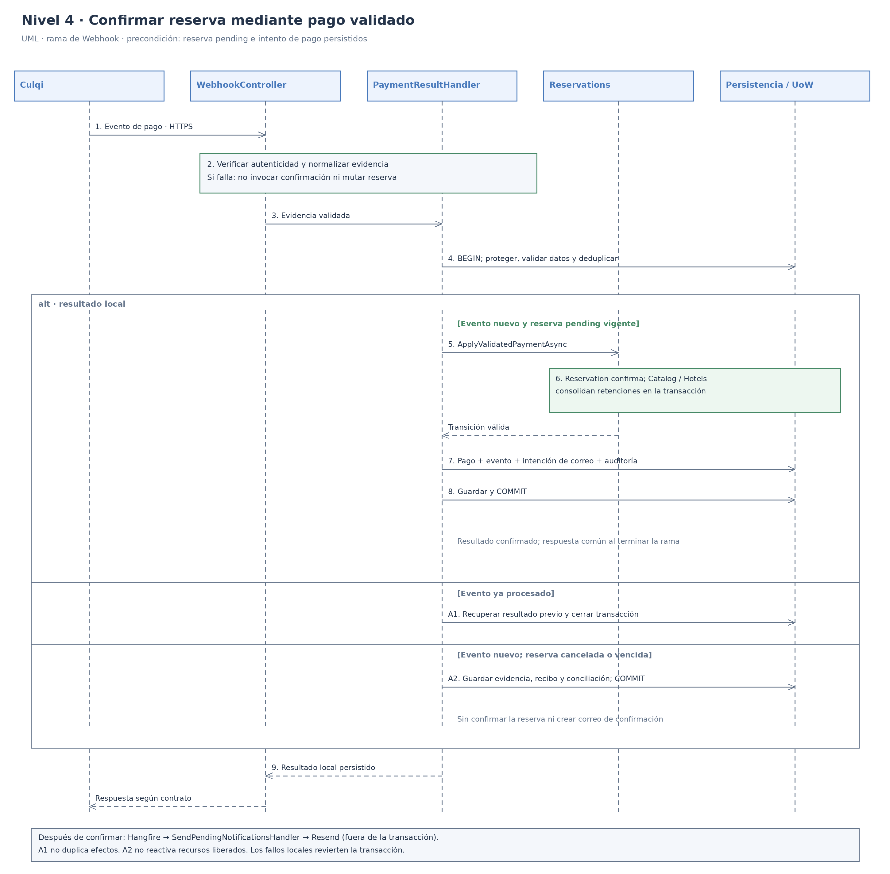

# Nivel 4 · Diagrama de código

> **Proyecto:** DMGOTRAVEL · **Módulos detallados:** Reservations, Payments y colaboradores del backend  
> **Modelo:** C4 · Nivel 4 de 4 · 

---

## 1. Objetivo

Mostrar **cómo se organiza el código** de los componentes del nivel 3: clases, interfaces, responsabilidades y colaboración. Se detalla el flujo **Confirmar una reserva mediante un pago validado**, cuya precondición es una reserva `pending` creada con cupos turísticos y alojamiento opcional retenidos transaccionalmente.

El documento cubre las responsabilidades de Identity, Catalog, Hotels, Reservations, Payments, Notifications, Reports y Audit, además de persistencia, almacenamiento y trabajos programados. Las figuras amplían los colaboradores críticos de reserva y pago; las tablas describen las clases principales del resto del sistema. No se presenta un diagrama único de todas las clases, que dificultaría su lectura.

| Aspecto | Descripción |
|---|---|
| Pregunta que responde | ¿Qué clases e interfaces se proponen dentro de los módulos y cómo colaboran? |
| Audiencia | Desarrolladores. |
| Notación | UML: diagramas de clases y de secuencia, utilizados para el nivel de código del modelo C4. |
| Por qué se amplía reserva y pago | Concentran atomicidad de inventario, estados, idempotencia e integración externa. El detalle UML se selecciona por complejidad; no implica que el resto del proyecto carezca de lógica de negocio. |
| Nivel anterior | `Nivel3-Diagrama-de-Componentes.md` |

Los nombres y operaciones representan **diseño propuesto**, no código ejecutable ni evidencia de clases implementadas. La propuesta respeta los requisitos y la separación de capas documentados; políticas pendientes como devoluciones, tokens y contrato específico de Culqi no se consideran resueltas por los diagramas.

---

## 2. Diagrama de clases

Las figuras muestran relaciones seleccionadas. Los colaboradores adicionales, DTOs, validadores, métodos de consulta y clases de otros módulos se precisan en las tablas. No se interpreta una clase omitida en la figura como una responsabilidad ausente.

### 2.1 Capas de Clean Architecture

| Capa | Contiene | Regla |
|---|---|---|
| **Presentación** | Controllers, requests y traducción de resultados HTTP. | Invoca Application mediante MediatR; no calcula precios ni utiliza repositorios concretos. |
| **Aplicación** | Commands, Queries, Handlers, DTOs, validadores e interfaces. | Coordina casos de uso, autorización y transacciones mediante contratos. Depende de Domain; no de Infrastructure. |
| **Dominio** | Entidades, objetos de valor, enumeraciones e invariantes. | No depende de HTTP, EF Core, PostgreSQL, Culqi, Resend, Google ni R2. |
| **Infraestructura** | Repositorios, adaptadores, mapeos EF Core y jobs. | Implementa contratos de Application con tecnologías concretas y utiliza entidades de Domain. |

> **Regla de dependencia:** Presentation → Application → Domain; Infrastructure → Application y Domain. A diferencia del ejemplo Marketplace, los puertos de DMGOTRAVEL se ubican en **Application**, conforme a su enfoque arquitectónico. `Program.cs` compone las implementaciones; esta función no autoriza al resto de Presentation a depender de Infrastructure.

### 2.2 Clases del módulo Reservations y colaboradores de negocio

| Clase | Tipo | Capa | Responsabilidad |
|---|---|---|---|
| `ReservationsController` | Controlador | Presentación | Recibe creación y consultas de reservas propias; convierte requests en Commands/Queries. |
| `CreateReservationCommand` / `CreateReservationValidator` | Entrada y validador | Aplicación | Expresan salida, personas y estancia opcional; validan formato y cantidades. No aceptan precios ni propietario como fuente de verdad. |
| `CreateReservationHandler` | Caso de uso | Aplicación | Obtiene actor, coordina retención y tarifas, crea pending con snapshots y guarda reserva y auditoría en un commit. |
| `Reservation` | Raíz de agregado | Dominio | Conserva propietario, componentes, total, vencimiento y estado. Protege creación, confirmación, cancelación y finalización. |
| `ReservationItem` | Componente del agregado | Dominio | Snapshot de referencia reservada, precio unitario, cantidad y subtotal; identifica noche cuando corresponde al alojamiento. |
| `ReservationStatus` | Enumeración | Dominio | Define `pending`, `confirmed`, `completed` y `cancelled`. No introduce `expired` como estado adicional: el vencimiento termina en cancelled. |
| `StayPeriod` | Objeto de valor | Dominio | Valida `checkOut > checkIn`; representa noches del intervalo [checkIn, checkOut). |
| `IReservationRepository` / `EfReservationRepository` | Puerto / repositorio | Aplicación / Infraestructura | Agrega y carga el agregado con la estrategia de concurrencia requerida. No confirma una parte de la transacción de forma independiente. |
| `IReservationReadStore` / `EfReservationReadStore` | Puerto / lector | Aplicación / Infraestructura | Devuelve DTOs paginados y filtrados por propiedad o permiso administrativo. |
| `IReservationPaymentPort` / `ReservationPaymentService` | API pública / servicio interno | Aplicación | Obtiene resumen cobrable y aplica evidencia ya validada por Payments; protege la transición de reserva y consolida retenciones mediante los módulos propietarios. |
| `CancelMyPendingReservationHandler` | Caso de uso | Aplicación | Exige cliente propietario y pending; cancela y libera recursos una sola vez. |
| `ExpirePendingReservationsHandler` | Caso de uso | Aplicación | Revalida estado y vencimiento bajo protección transaccional; cancela y libera de forma idempotente. |
| `CompleteReservationHandler` | Caso de uso | Aplicación | Permite al administrador completar una reserva confirmed cuyo servicio finalizó. completed es terminal. |
| `CancelConfirmedReservationByAdminHandler` | Caso de uso condicionado | Aplicación | Solo se habilita al definir la política administrativa y de devolución; no reutiliza ciegamente la cancelación pending. |
| `Offer` / `TourDeparture` / `TourHold` | Agregados y entidad de retención de Catalog | Dominio | Oferta activa, salida válida, tarifas y cupos; retención asociada a reserva y liberación única. Los límites exactos de agregados requieren cerrar el modelo de dominio. |
| `ITourReservationPort` / `TourReservationAdapter` | Puerto / adaptador interno | Aplicación / Infraestructura | `HoldAndQuoteAsync`, `ConfirmHoldAsync`, `ReleaseHoldAsync`; aplica reglas Catalog y concurrencia en la transacción compartida. |
| `Hotel` / `RoomType` / `RoomInventory` / `HotelHold` | Entidades de Hotels | Dominio | Hotel y tipo activos, inventario por tipo y noche, cantidades de habitaciones y retenciones asociadas a la reserva. |
| `IHotelReservationPort` / `HotelReservationAdapter` | Puerto / adaptador interno | Aplicación / Infraestructura | Valida todas las noches y tarifas; retiene, consolida o libera habitaciones. No calcula disponibilidad usando solo número de huéspedes. |
| `CreateOfferHandler` / `UpdateOfferHandler` | Casos de uso de Catalog | Aplicación | Administración de ofertas sin cambiar snapshots históricos; publica o desactiva según permisos. |
| `AdjustRoomInventoryHandler` / `SetNightRateHandler` | Casos de uso de Hotels | Aplicación | Administración de inventario y tarifas con protección de compromisos existentes y auditoría. |
| `IUnitOfWork` / `EfUnitOfWork` / `AppDbContext` | Puerto / coordinador / contexto | Aplicación / Infraestructura | Unifica conexión, seguimiento y transacción scoped; confirma o revierte el conjunto de cambios locales. |

El total se obtiene de tarifas del backend: componente turístico más la suma de habitaciones por tarifa de cada noche. Los puertos entregan DTOs de cotización, no entidades EF de otros módulos. Si falla una noche, se revierte también el bloqueo turístico. Una lectura ordinaria del repositorio no equivale a un bloqueo: el adaptador debe implementar concurrencia real y probarla contra PostgreSQL.

### 2.3 Clases del módulo Payments y colaboradores de identidad y soporte

| Clase | Tipo | Capa | Responsabilidad |
|---|---|---|---|
| `PaymentsController` | Controlador | Presentación | Recibe inicio de pago para una reserva propia; no toma el monto del cliente como autoridad. |
| `CulqiWebhookController` | Controlador | Presentación | Recibe el evento externo y delega validación y procesamiento; no usa JWT client para autenticar a Culqi. |
| `StartPaymentHandler` | Caso de uso | Aplicación | Valida propietario y reserva cobrable, persiste intento y solicita la operación externa fuera de la transacción de inventario. |
| `ProcessPaymentResultHandler` | Caso de uso | Aplicación | Punto común para resultado síncrono y evento validado: deduplica, registra evidencia, solicita confirmación y crea intención de correo y auditoría en una transacción local. |
| `Payment` / `PaymentAttempt` | Agregado / entidad de intento | Dominio | Relaciona pago y reserva; conserva importes, moneda, identificadores externos y resultado de cada intento. |
| `PaymentEventReceipt` | Registro de procesamiento | Dominio | Conserva identidad externa y resultado aplicado; una restricción única en persistencia respalda la deduplicación. |
| `IPaymentGateway` / `CulqiPaymentGateway` | Puerto / adaptador | Aplicación / Infraestructura | Traduce solicitudes y resultados de Culqi; no decide por sí solo que una reserva está confirmada. |
| `PaymentGatewayResult` / `ValidatedPayment` | DTOs internos | Aplicación | Distinguen respuesta técnica y evidencia comprobada. Un timeout es resultado desconocido, no rechazo automático. ValidatedPayment no se acepta directamente del body público. |
| `ICulqiEventVerifier` / `CulqiEventVerifier` | Puerto / adaptador propuesto | Aplicación / Infraestructura | Comprueba autenticidad y consistencia de la evidencia conforme al contrato oficial pendiente de detalle; no se inventa una firma o cabecera. |
| `IPaymentRepository` / `EfPaymentRepository` | Puerto / repositorio | Aplicación / Infraestructura | Persiste pagos, intentos y referencias; colabora con la unidad de trabajo. |
| `User` / `IIdentityService` / `AspNetIdentityService` | Entidad / puerto / adaptador de Identity | Dominio / Aplicación / Infraestructura | Cuenta, rol, perfil y baja lógica; credenciales locales administradas mediante Identity. El registro público solo crea client. |
| `RegisterClientHandler` / `LoginWithPasswordHandler` / `LoginWithGoogleHandler` | Casos de uso de Identity | Aplicación | Registro y autenticación por credenciales locales o identidad externa validada. |
| `IExternalIdentityProvider` / `GoogleIdentityProvider` / `ITokenService` | Contratos / adaptador | Aplicación / Infraestructura | Valida Google y emite tokens propios mediante implementación de servidor; vinculación y ciclo de tokens pendientes de detalle. |
| `UpdateMyProfileHandler` / `RequestAccountDeletionHandler` | Casos de uso de Identity | Aplicación | Modifica campos autorizados y aplica baja lógica conservando el historial requerido. |
| `ICurrentUser` / `IClock` | Interfaces compartidas | Aplicación | Proveen actor validado y hora controlable; las pruebas no necesitan fabricar contexto HTTP ni depender del reloj real. |
| `Notification` / `DeliveryAttempt` | Entidades de Notifications | Dominio | Intención única de correo e historial de entrega, propuestas para envío recuperable. |
| `INotificationPort` / `QueuePaymentConfirmationHandler` | Puerto / caso de uso | Aplicación | Registra una intención única dentro del commit de confirmación; no envía correo mientras mantiene bloqueado inventario. |
| `SendPendingNotificationsHandler` / `IEmailService` / `ResendEmailService` | Caso de uso / puerto / adaptador | Aplicación / Infraestructura | Envía mediante Resend fuera de la transacción de pago, registra resultado y permite recuperación. |
| `GetManagementIndicatorsHandler` / `ExportManagementReportHandler` | Casos de uso de Reports | Aplicación | Calculan indicadores y exportan con filtros y permiso admin; evitan doble conteo por intentos. |
| `IReportsReadStore` / `EfReportsReadStore` / `IReportExporter` | Puertos / lector | Aplicación / Infraestructura | Proyecciones transversales acordadas y exportación; no modifica agregados de otros módulos. |
| `AuditLog` / `IAuditWriter` / `EfAuditWriter` | Entidad / puerto / adaptador | Dominio / Aplicación / Infraestructura | Anexa actor, acción, entidad, identificador, instante y cambios relevantes sin secretos. |
| `SearchAuditLogsHandler` / `IAuditReadStore` | Caso de uso / puerto | Aplicación | Consulta administrativa paginada; no expone edición o eliminación de auditoría. |
| `IObjectStorage` / `R2ObjectStorage` | Puerto / adaptador compartido | Aplicación / Infraestructura | Almacena y recupera multimedia para Catalog y Hotels; valida permisos en los casos de uso consumidores y prevé limpieza de objetos huérfanos. |
| `ExpireReservationsJob` / `DispatchNotificationsJob` | Adaptadores de ejecución | Infraestructura | Hangfire invoca los casos de uso de vencimiento y envío; cada ejecución crea su scope. |
| `ReconcilePaymentHandler` / `ReconcilePaymentsJob` | Caso de uso / job propuestos | Aplicación / Infraestructura | Revisan resultados desconocidos o tardíos según el flujo de proveedor; no realizan otro cobro ciego ni presuponen devolución automática. |
| `Program` / `DependencyInjection` | Composición | Host / Infraestructura | Registra Handlers, contratos, contexto, adaptadores y jobs. No contiene reglas del negocio. |

Las operaciones administrativas y las consultas de reservas exigen rol y propiedad donde corresponde, también en Application. La existencia de una interfaz no verifica la autenticidad de un pago ni evita sobreventa. Los DTOs, restricciones únicas, transacciones y pruebas de integración deben respaldar esas garantías.

### 2.4 Notación UML utilizada

| Símbolo | Significado | Ejemplo |
|---|---|---|
| Línea continua con flecha abierta | Asociación dirigida: conserva una referencia. | Handler → repositorio o puerto. |
| Línea discontinua con flecha abierta | Dependencia: usa o crea. | Handler «crea» Reservation. |
| Línea discontinua con triángulo hueco | Realización: implementa una interfaz. | EfReservationRepository → IReservationRepository. |
| Rombo relleno | Composición: la parte pertenece al agregado. | Reservation ◆ ReservationItem. |
| `«interface»` | Interfaz sin implementación. | IPaymentGateway. |
| `-` y `+` | Atributo privado y operación pública. | `-status`, `+CancelPending()`. |
| `1`, `1..*` | Multiplicidad. | Una reserva contiene uno o más componentes históricos. |
| `alt` y línea de vida | Rama alternativa y participante de secuencia. | Resultado nuevo frente a evento ya aplicado o pago tardío. |

---

## 3. Diagrama de secuencia: confirmar una reserva mediante un pago validado

**Precondición:** la reserva ya existe en pending con precios históricos y retenciones persistidas. StartPaymentHandler registró un intento y solicitó el pago fuera de la transacción de inventario. La figura amplía la recepción de un evento; el resultado síncrono converge en el mismo caso de uso.

| Paso | Origen → destino | Acción |
|---|---|---|
| 1 | Culqi → CulqiWebhookController | Notifica un resultado de pago por HTTPS. El cuerpo por sí solo no se considera confiable. |
| 2 | Controller → verificador / Application | Verifica autenticidad según contrato Culqi y normaliza evidencia. La verificación de red necesaria ocurre antes de adquirir bloqueos de inventario. |
| 3 | Controller → ProcessPaymentResultHandler mediante MediatR | Entrega evidencia validada al procesamiento común; no expone este DTO como un endpoint de confirmación libre. |
| 4 | Handler → IUnitOfWork / PostgreSQL | Inicia transacción local, protege intento y reserva en orden consistente y comprueba identidad externa. Revalida monto, moneda, referencia y estado actual. |
| 5 | Handler → IReservationPaymentPort | Si el evento es nuevo y corresponde a una pending vigente, aplica el pago validado mediante el servicio público de Reservations. |
| 6 | Servicio de Reservations → Reservation / Catalog / Hotels | Protege pending → confirmed y consolida retenciones existentes; usa los puertos propietarios de cupos y habitaciones dentro de la misma transacción. |
| 7 | Handler → repositorios, Notifications y Audit | Persiste pago y recibo de evento; crea intención única de correo y auditoría. No invoca Resend en esta transacción. |
| 8 | IUnitOfWork → PostgreSQL | Guarda y confirma todos los cambios. Una excepción local revierte el conjunto; no revierte el cobro externo ya realizado. |
| 9 | Handler → Controller → Culqi | Devuelve el resultado persistido y acuse compatible con el contrato del proveedor. El código HTTP exacto se definirá con esa integración. |
| 10 | Hangfire → SendPendingNotificationsHandler → Resend | Recupera intención pendiente y envía fuera de la transacción; conserva resultado o reintento. Esta etapa es posterior al commit. |
| A1 | Evento ya procesado | No repite la transición ni crea otro correo; devuelve el resultado previamente registrado. La deduplicación se respalda con unicidad y control transaccional. |
| A2 | Reserva cancelada o vencida / pago excedente | Conserva evidencia y deriva a conciliación; no reactiva disponibilidad ni confirma sin recursos. |
| A3 | Evidencia no auténtica o referencia/importe/moneda incompatibles | Rechaza o registra la incidencia según corresponda; no confirma la reserva. |
| A4 | Pago rechazado o resultado desconocido | Registra el resultado del intento. La reserva no se confirma: puede seguir pending hasta cancelación o vencimiento; no se borra como en el ejemplo Marketplace. |

La figura agrupa transacciones y persistencia bajo el participante `Persistencia / UoW` para limitar participantes; los contratos y clases concretas están en las tablas. El participante `Reservations` representa su servicio público, agregado y colaboración con Catalog/Hotels, no una llamada HTTP.

La intención persistida evita perder el correo entre commit y programación. La entrega externa exactamente una vez no se presume: si Resend acepta el envío y se pierde la respuesta, se requiere deduplicación compatible con el proveedor o conciliación. Un fallo de correo nunca revierte un pago validado.

---

## 4. Patrones y principios que se ven en este nivel

| Elemento del diagrama | Patrón o principio |
|---|---|
| CulqiPaymentGateway, GoogleIdentityProvider, ResendEmailService y R2ObjectStorage | **Adapter**: traduce contratos internos a integraciones externas. |
| IReservationRepository / EfReservationRepository y repositorios de otros módulos | **Repository**: separa persistencia de la coordinación de negocio. |
| IUnitOfWork / EfUnitOfWork / AppDbContext | **Unit of Work**: delimita un commit local compartido; no sustituye el control de concurrencia. |
| Commands, Queries, Handlers e ISender | **Mediator y CQRS**: despacho de casos de uso y separación de operaciones de lectura/escritura. MediatR no es un broker durable. |
| Intención Notification guardada con la confirmación | **Transactional Outbox propuesto** para correo: entrega recuperable tras commit, sin requerir un bus distribuido. |
| PaymentEventReceipt y transiciones idempotentes | **Idempotent Consumer propuesto**: eventos o ejecuciones repetidas no duplican efectos locales. |
| Handlers reciben puertos por constructor; Program compone adaptadores | **Inversión de dependencias**: Application no crea clientes SDK ni repositorios concretos. |
| Controllers, casos de uso, entidades y adaptadores con responsabilidades separadas | **Responsabilidad única**: cada clase agrupa un motivo coherente de cambio. |
| Puertos de disponibilidad, lectura, auditoría y envío separados | **Segregación de interfaces**: cada consumidor conoce las operaciones que necesita. |
| Sustitución de adaptadores con contratos semánticos comprobados | **Abierto/cerrado y Liskov**: extender sin propagar detalles; respetar resultados, errores, precondiciones y efectos. |
| Reservations usa Catalog/Hotels y Payments usa Reservations mediante puertos | **Monolito modular**: colaboración interna por API pública del módulo, sin acceso arbitrario a escrituras ajenas. |

---
